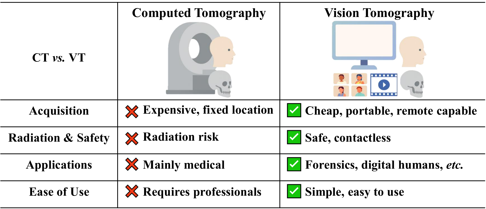
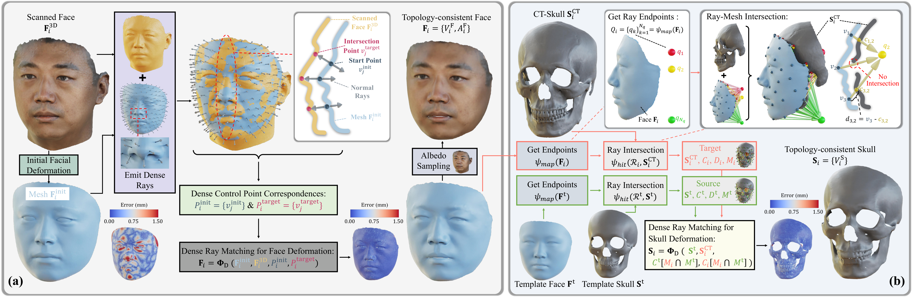
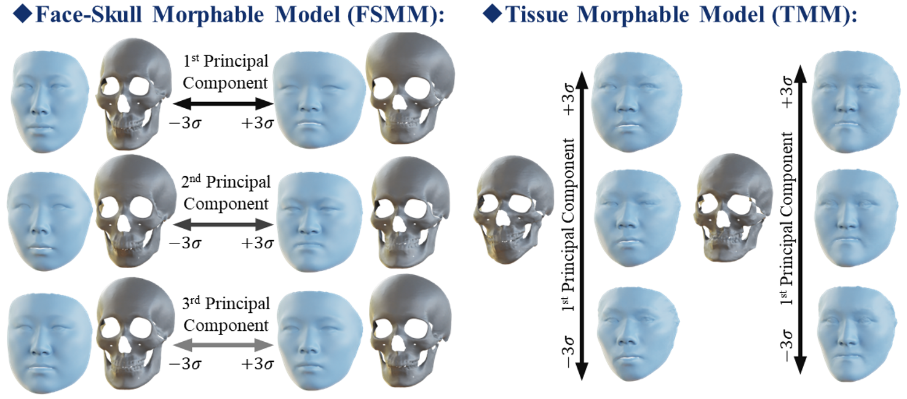
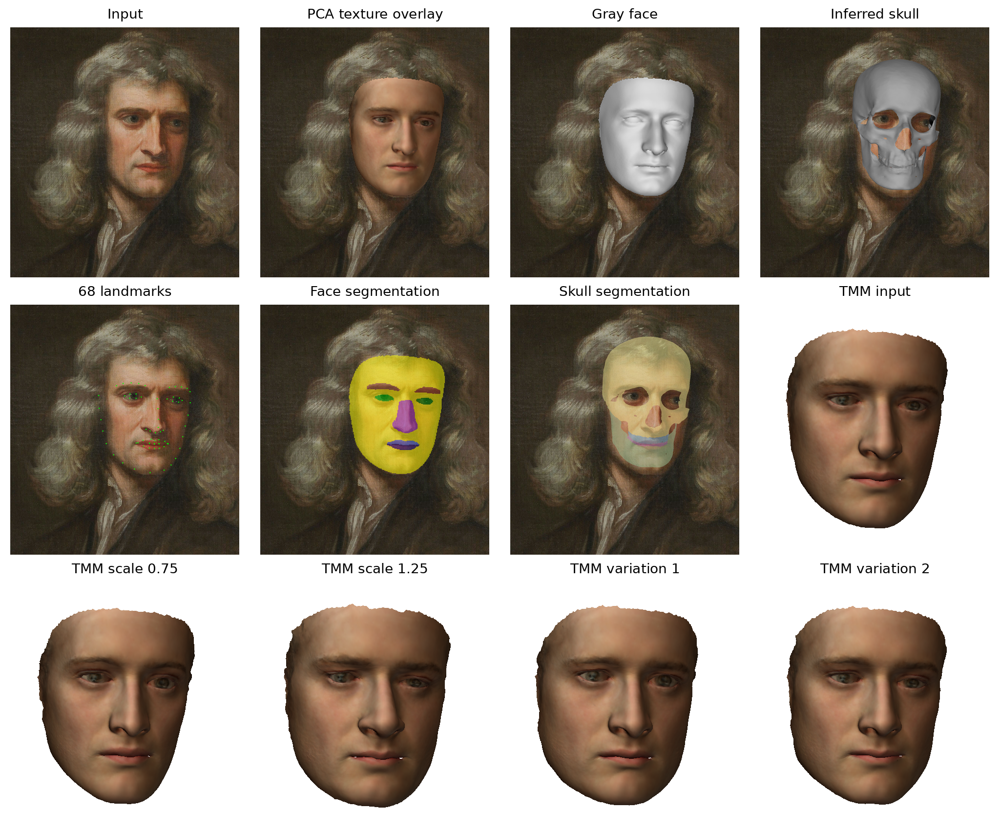

# Vision Tomography and 3D Bidirectional Face-Skull Morphable Model



## Abstract

The 3D Bidirectional Face–Skull Morphable Model (BFSM) forms the foundation of our proposed Vision Tomography (VT), Tele-Cranio, and subsequent research. This repository provides the open-source code for these works.

Vision Tomography (VT) and Tele-Cranio aim to reconstruct both external surfaces and internal anatomical structures (e.g., bones) using only visual inputs, offering a low-cost, radiation-free, and portable alternative to conventional CT and MRI imaging, with the goal of approaching their reconstruction accuracy.


Currently, our methods focus on facial and skull reconstruction. However, we believe these technologies have broad potential in medical imaging, forensic science, and other fields, and deserve further exploration.

We welcome collaborations of all kinds. For inquiries, please contact the core contributors: [Zidu Wang](https://scholar.google.com/citations?user=7zD5f0IAAAAJ&hl=zh-CN&oi=ao) (email: [wangzidu0705@gmail.com](mailto:wangzidu0705@gmail.com)), [Meng Xu](https://openreview.net/profile?id=~Meng_Xu15), [Hengyuan Ma](https://scholar.google.com/citations?user=nrnLH_sAAAAJ&hl=zh-CN), [Tao Song](mailto:songtao@psh.pumc.edu.cn), [Zhen Lei](http://www.cbsr.ia.ac.cn/users/zlei/), [Xiangyu Zhu](https://xiangyuzhu-open.github.io/homepage/).


⚠️ **Disclaimer: This project is intended for research and testing purposes only. It must not be used for medical or clinical applications, and commercial use is strictly prohibited.**

## Getting started

1. Configure the [environment](environment/README.md): install the complete profile or only the capabilities required by your module.
2. Download the BFSM models and registration templates from [Hugging Face](https://huggingface.co/datasets/Zidu-Wang/BFSM), then obtain the extra provider files required by your module. Example inputs and reference outputs are included in this repository. All download commands and target paths are in the [single asset setup guide](assets/README.md).
3. Choose a module below. Run commands from this repository's root unless a guide specifies otherwise.

## Repository layout and Python packages

| Directory | Purpose |
| --- | --- |
| `assets/` | Scientific models, templates, provider download instructions and format specification |
| `data/` | Inputs, selected reference outputs and ignored local runs |
| `common/` | Shared `bfsm_core` implementation and runtime documentation |
| `modules/` | Five workflow packages, each with its own README, source, figures and package metadata |
| `environment/` | Complete setup and capability profiles |

## Modules

### 1. Topology consistency and model construction

One especially fascinating question in topology-consistent data processing is whether an existing topology-consistent surface A can help establish topological consistency for another related but more complex surface B. BFSM and [SRM-Hair](https://github.com/wang-zidu/SRM-Hair) are probably two attempts to explore this direction.


Register aligned face/skull surfaces into a common topology, then build PCA models from your registered face/skull pairs. Both textured-scan and CT-only inputs are supported.



[Data preparation, CT-only workflow and model construction →](modules/01_topology_and_modeling/README.md)

### 2. Morphable models and tissue variation

The Face–Skull Morphable Model (FSMM) varies face and skull together through shared identity coefficients. The Tissue Morphable Model (TMM) varies soft tissue while keeping the displayed skull fixed.



[BFSM paper, model figures and interactive viewers →](modules/02_morphable_models/README.md)

### 3. Image → face and skull

Reconstruct paired face/skull geometry from an image, then generate optional conditioned tissue variations around the inferred skull.



[Image reconstruction setup and demonstration →](modules/03_image_reconstruction/README.md)

### 4. Postoperative prediction

Predict facial changes from a textured scan/CT skull or a photograph-derived FSMM pair. Both routes share the predictor; scans use ARAP detail transfer, while photographs produce the predicted FSMM face directly.


*Synthetic skull edits are shown in gold.*

[Editing and postoperative prediction demonstration →](modules/04_postoperative/README.md)

### 5. Facial FLAME applications

Use native BFSM models in FLAME facial topology, fit an external FLAME model to a BFSM face, or reconstruct through a DECA image frontend.


[FLAME representations, fitting and DECA →](modules/05_applications/README.md)


## License

BFSM is provided under the [BFSM Research License](LICENSE) for noncommercial research and testing. It does not permit medical/clinical use. Third-party components and externally obtained models retain their own terms; see [THIRD_PARTY_NOTICES](THIRD_PARTY_NOTICES.md).

## Citation

- [BFSM: 3D Bidirectional Face-Skull Morphable Model](https://arxiv.org/abs/2509.24577) — arXiv preprint.
- Vision Tomography: Towards Portable 3D Bidirectional Face-Skull Inference from Visual Data — submitted to IEEE Transactions on Image Processing (TIP); under review.
- [Tele-Cranio: A CT-free AI Solution for Remote Diagnosis and Planning of Craniomaxillofacial Deformities](https://www.researchsquare.com/article/rs-10262203/v1) — accepted by npj Digital Medicine (Nature Portfolio).

If you use our work in your research, please cite:

```bibtex
@misc{wang2025bfsm,
  title={BFSM: 3D Bidirectional Face-Skull Morphable Model},
  author={Zidu Wang and Meng Xu and Miao Xu and Hengyuan Ma and Jiankuo Zhao and Xutao Li and Xiangyu Zhu and Zhen Lei},
  year={2025},
  eprint={2509.24577},
  archivePrefix={arXiv},
  primaryClass={cs.CV},
  url={https://arxiv.org/abs/2509.24577}
}

@misc{wang_vision_tomography,
  title={Vision Tomography: Towards Portable 3D Bidirectional Face-Skull Inference from Visual Data},
  author={Zidu Wang and Meng Xu and Miao Xu and Hengyuan Ma and Jiankuo Zhao and Xutao Li and Zhen Lei and Xiangyu Zhu}
}

@misc{xu2026telecranio,
  title={Tele-Cranio: A CT-free AI Solution for Remote Diagnosis and Planning of Craniomaxillofacial Deformities},
  author={Meng Xu and Zidu Wang and Lei Zhang and Chuanqi Qin and Xiaole Wang and Jiayu Zhou and Zhen Lei and Hengyuan Ma and Tao Song and Xiangyu Zhu},
  year={2026},
  doi={10.21203/rs.3.rs-10262203/v1},
  url={https://www.researchsquare.com/article/rs-10262203/v1}
}
```
