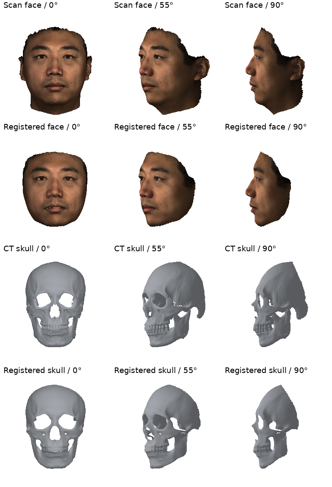
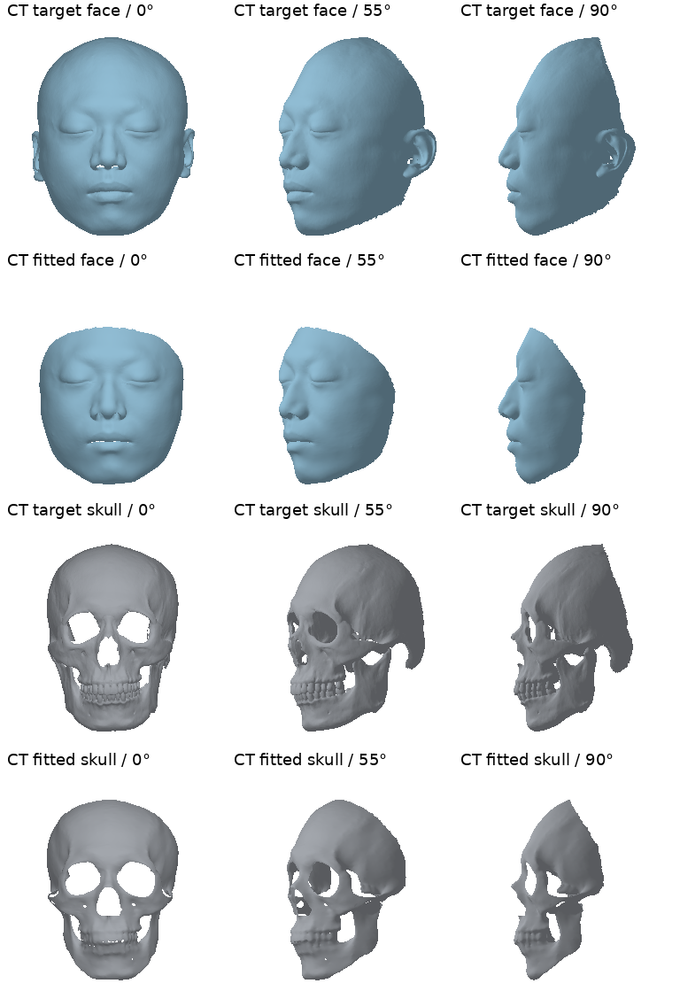

# 1. Topology consistency and institutional PCA construction

[Project home](../../README.md) · [Environment](../../environment/README.md) · [Assets](../../assets/README.md)

Install the shared core and this workflow in your configured environment from the repository root:

```bash
python -m pip install -e . -e modules/01_topology_and_modeling
```

Two input paths produce corresponding face/skull geometry. Both require mutually aligned face/skull inputs. Neither establishes independent alignment between different acquisitions automatically. Use the [registration environment](../../environment/README.md) and [registration assets](../../assets/README.md).

## Prepare your input alignment

CT skin and skull must retain their shared acquisition coordinates; scanner skin must be rigidly co-registered to CT skin. The initial frontal direction is +Z and the crown points toward +Y. [Anatomical alignment and MeshLab inspection](docs/REGISTRATION.md#anatomical-alignment-and-initial-orientation) shows the actual surface positions, axes and a reusable inspection command.


## Original textured-scan path

Inputs: a textured 3D face scan, an already aligned CT face surface and CT skull.

```bash
python -m bfsm_topology.demo \
  --input data/input/sample_001/raw --output data/output/runs/sample_001/registration \
  --device cuda:0 --deterministic --seed 0
```

See the [registration guide](docs/REGISTRATION.md) for input files, stages and parameters.

**Role of CT face:** the original `face.obj` is transformed together with the scan and skull during standardization/pose normalization. The face-fitting RGB/depth and face-NICP target come from `face_scan.obj`; CT face itself is not a target in those losses. The inputs are already mutually aligned; the code does not independently align CT face to a scanner face.

The included original inputs are supplied in `data/input/sample_001/raw/`: `face_scan.obj` with its material/image, CT `face.obj`, and CT `skull.obj`. Their vertex counts are 64513, 45741 and 54781, respectively. Registration produces a corresponding 35709-vertex face and 23207-vertex skull.

Reference products are under `data/output/reference/01_topology/sample_001/registration/`. New execution writes `posed/topology_face.obj` and `posed/topology_skull.obj` in one normalized frame, together with the original-resolution posed surfaces for subsequent ARAP. `world/` and `coordinate_transform.npz` provide the corresponding original scan frame.



*Original input surfaces and their registered template-topology outputs; one example case.*

## CT-only registration

Some institutions may have access to CT scanning but not a textured 3D face scanner. For this situation, we provide a CT-only registration workflow for reference only.

Use CT face and CT skull in a shared frame, plus **known 68-point XYZ facial landmarks** in the corresponding template order. The geometry-only route uses landmark fitting, depth refinement and face/skull NICP.

The example uses the actual original CT `data/input/sample_001/raw/face.obj` and `data/input/sample_001/raw/skull.obj`, with `data/input/sample_001/ct_only/landmarks3d.toml`. The example annotations were prepared directly on the CT surface using multiview geometry inspection and surface-point selection. Manual annotation following the [68-point order](docs/CT_ONLY.md#annotating-the-68-landmarks) is recommended; Agent-assisted selections require user review.

```bash
python -m bfsm_topology.preprocess_pipeline.ct_only \
  --face data/input/sample_001/raw/face.obj \
  --skull data/input/sample_001/raw/skull.obj \
  --landmarks3d data/input/sample_001/ct_only/landmarks3d.toml \
  --output-dir data/output/runs/ct_only --device cuda:0
```

See [CT_ONLY](docs/CT_ONLY.md) for schemas, shared coordinate transforms, default stages and landmark validation.



*Original CT face/skull inputs and corresponding topology outputs.*

## Build your institution's geometry models

After registering **all** private pairs into a common template frame and scale, choose a component count for your cohort. The command below uses 50 as an example:

```bash
python -m bfsm_topology.construction.build --manifest /path/to/private/aligned_pairs.toml \
  --template assets/models/fsmm_200.npz --components 50 \
  --output /path/to/private/institution_models
```

If you use a custom skull topology, replace `--template assets/models/fsmm_200.npz` with a matching template NPZ containing your skull triangle indices and vertex count, together with the corresponding face–skull pair indices.

The [construction guide](docs/PCA_CONSTRUCTION.md) defines the manifest, normal buffers, topology and matching-pair requirements. FSMM concatenates face/skull with shared coefficients. TMM independently fits paired `skull - face` vectors. Means and standard-deviation-scaled bases follow the original PCA equations. No automatic mirroring, independent recentering, or individual coefficient export is performed.

For `N` paired samples and `K` components, `K` must not exceed `N - 1` or the numerical rank of either centered PCA input matrix. The supplied models use 200 components; new models can use a different count. A non-patient six-pair synthetic check requires only the CPU profile:

```bash
python -m bfsm_topology.construction.synthetic_smoke --output data/output/runs/synthetic_pca
```

Original supplied models are never overwritten. A different topology can support PCA model construction, but is not automatically compatible with the supplied 35709/23207 image and tissue decoders.
