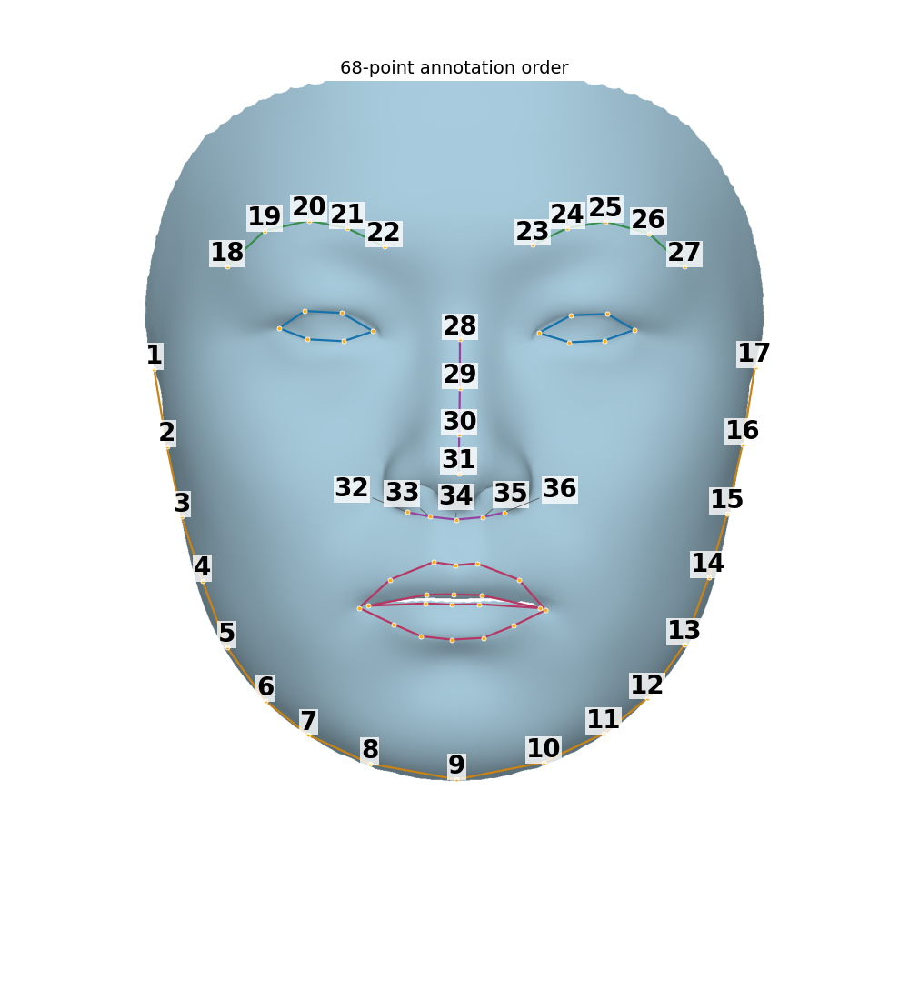
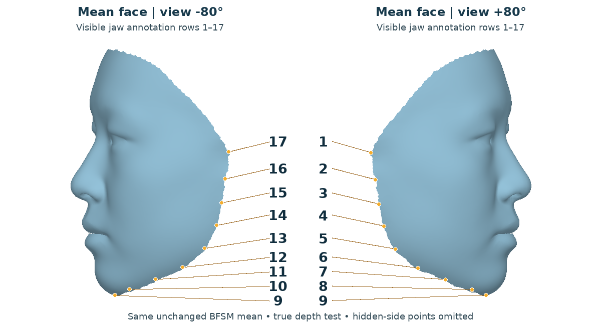
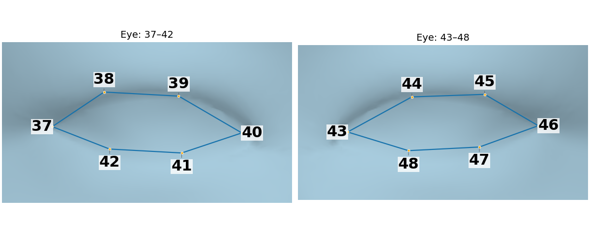
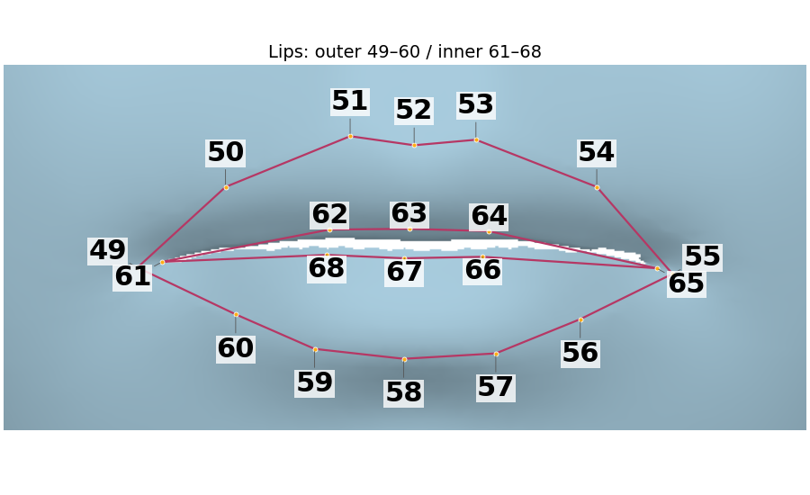
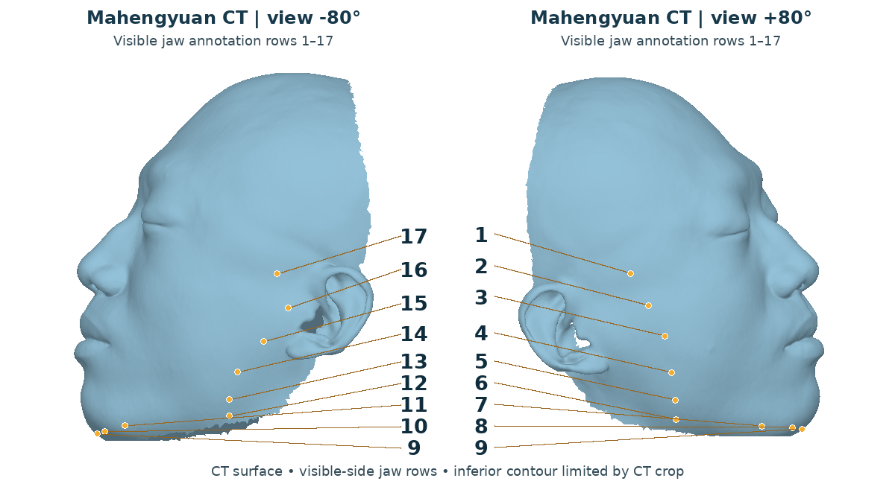

# CT surfaces with known 3D landmarks

Register a CT-derived facial surface and skull into the BFSM template topology using 68 known 3D facial correspondences. This geometry-only route needs no photograph, scan texture, FAN detector or image reconstruction network and evaluates no photometric loss.

## Inputs and relationship to textured registration

The textured-scan route standardizes `face_scan.obj` and applies the same transform to the already aligned `face.obj` and `skull.obj`. Its RGB/depth observations and face NICP target come from `face_scan.obj`; the CT facial surface is an aligned intermediary, not its fitting target. The CT-only route instead uses the CT face itself for depth observations and NICP, with explicit XYZ landmark constraints.

- `--face`: triangular CT skin/facial surface; arbitrary input topology, no color or UV required.
- `--skull`: skull surface from the same case, coordinate system and units.
- `--landmarks3d`: TOML file with 68 XYZ points in the exact semantic order of `BFM/ldm68.npy`. Two-dimensional points with zero depth are not valid 3D annotations.

The following is a field-layout illustration, not a runnable annotation; replace both string placeholders with full numeric arrays. A complete example is supplied below.

```toml
schema_version = 1
coordinate_space = "ct_mesh_world"
units = "m"
template_landmark_indices = ["68 zero-based integer indices matching ldm68.npy"]
points = ["68 XYZ numeric coordinate triples"]

[provenance]
kind = "manual_CT_annotation_or_documented_3D_correspondence"
```

Both surfaces and all points must use one right-handed frame and the same units (`m`, `mm`, or another explicit unit). The command does not resolve unknown alignment between separate CT series. It checks finite coordinates, point count, non-collinearity, template-index order and surface proximity. Maximum distance to the nearest CT-face vertex must not exceed 2% of the landmarks' largest axis-aligned extent. These checks do not verify anatomical annotation semantics. NICP snaps landmarks to CT vertices for its indexed interface; coarse/depth fitting uses the original XYZ coordinates. Snapping distances are reported.

## Annotating the 68 landmarks

Annotate directly on the CT facial surface in a 3D mesh editor. Use the numbered mean-face diagram below to identify each landmark; the displayed numbers are **1–68 annotation rows**, not mesh vertex IDs. `template_landmark_indices` stores the matching zero-based template vertex IDs and must retain the supplied order.





The side views show the visible jaw points only; hidden-side points are omitted. Inspect the jaw correspondences from both sides when annotating.





| Rows | Region and order |
| --- | --- |
| 1–17 | Cutaneous facial outline, excluding the ears, from image-left through chin to image-right in the reference frontal view |
| 18–22, 23–27 | Image-left and image-right eyebrows, respectively; each runs left to right in the reference view |
| 28–31 | Nose bridge, top to tip |
| 32–36 | Nose base, from image-left ala through the base to image-right ala |
| 37–42 | Image-left eyelid loop: outer corner → upper margin → inner corner → lower margin → outer corner |
| 43–48 | Image-right eyelid loop: inner corner → upper margin → outer corner → lower margin → inner corner |
| 49–60 | Outer lip loop: image-left corner → upper lip → image-right corner → lower lip → image-left corner |
| 61–68 | Inner lip loop: image-left inner corner → upper inner margin → image-right inner corner → lower inner margin → image-left inner corner |

1. Load only the CT face and its aligned CT skull. Keep their original coordinates and units; use frontal, oblique and profile views to identify the actual surface features.
2. Pick the 68 XYZ surface positions in the diagram's order. Inspect both eye corners and both lip corners before completing each loop. For closed eyes or lips, follow the observed margins; do not copy the open mean-face shape onto the subject.
3. Rotate the mesh and check every point's depth and surface attachment. Distinguish facial outline from ears and acquisition cut boundaries. CT surface geometry alone may not identify eyebrow hair or the texture-defined lip border; review those correspondences explicitly.
4. Save the XYZ rows, coordinate frame, units and unchanged template-index array in the TOML format above, then run registration. Its geometric input checks do not replace anatomical review.

Manual annotation and review are recommended. An Agent can assist with point selection, but every result requires user review; the project does not guarantee the anatomical accuracy of automated annotations.

## Coordinates and outputs

A proper-rotation similarity is estimated between neutral BFM template landmarks and the input XYZ points. With row vectors:

```text
world = scale * canonical @ rotation + translation
canonical = (world - translation) @ rotation.T / scale
```

The same transform is applied to both CT surfaces and all landmarks. Subsequent fitted pose/scale acts on the template, without moving CT face and skull independently.

The canonical axes follow the BFM template; they are not a prescribed clinical horizontal plane. The CT target includes ears and acquisition boundaries that are outside the corresponding template face; compare their shared facial region rather than their complete bounding boxes. A slightly head-up frontal view is not evidence that skin and bone have been separately rotated. Compare meshes in the same saved frame, using the [MeshLab alignment inspection](REGISTRATION.md#inspect-in-meshlab).

CT-only fitting replaces scanner RGB and automatically detected image landmarks with the supplied XYZ correspondences and CT-surface depth. It therefore shares the NICP implementation with textured registration but has different observations and fitting terms; the resulting vertex correspondences need not be identical. The terminal report gives final 68-point RMS/maximum errors in the input units. Inspect these separately from surface proximity: a template can lie near the CT skin while individual semantic landmarks remain displaced.


| Output | Meaning |
| --- | --- |
| `fit_parameters.npz` | Fitted parameters and reversible `world_scale`, `world_rotation`, `world_translation`, `world_units` |
| `canonical/face_target.obj`, `canonical/skull.obj` | Input surfaces in the shared canonical frame |
| `canonical/fitted_face.obj` | Landmark/depth-fitted initialization |
| `canonical/topology_face.obj`, `canonical/topology_skull.obj` | Fixed-order topology pair in the canonical frame |
| `topology_face.obj`, `topology_skull.obj` | Topology pair transformed back to original CT world coordinates and units |

Settings, input/asset hashes, provenance and diagnostics are printed to the terminal. Do not mix world-space outputs with normalized models without applying the appropriate common transform. Preserve all vertices and their order, for example with `trimesh.load(..., process=False, maintain_order=True)`; do not merge coincident vertices or remove unused vertices.

## Stages and defaults

1. Validate surfaces/landmarks and estimate their shared canonical transform.
2. Run 500 coarse iterations fitting BFM09's 80 identity and 64 expression coefficients, rotation, translation and log-scale. Loss: `100 * mean(||predicted_XYZ - input_XYZ||²)`, plus squared-coefficient sums weighted `1e-3` for identity and `0.8e-3` for expression. Adam learning rate: `1e-2`.
3. Run 1000 depth iterations, retaining the landmark/regularization terms and adding `30 * depth_MSE`, averaged over pixels where both surfaces are visible. Depth is rendered mesh geometry, not photograph-estimated depth. Adam learning rate: `1e-3`; default resolution: 1024. This overlap-normalized depth objective differs from the textured route's masked-full-image normalization.
4. Use the existing face NICP implementation with the CT face as target and the 68 indexed landmarks as anchors. No scan-color transfer is performed.
5. Use the existing three-group face-to-skull ray controls and skull NICP to produce corresponding skull topology.

NICP uses 150 outer iterations, 50 inner iterations per outer iteration and 100 inner iterations for the first, with the existing `fine_grain.toml` stage weights. The strict runtime is enabled by default: seed 0, deterministic CUDA reductions and ordered equal-depth candidates. `--native` selects the upstream backend without a repeatability guarantee. CPU supports input/model checks; full-resolution depth fitting and NICP are intended for the configured CUDA environment.

## Assets and commands

Follow the [registration setup](REGISTRATION.md) for `BFM09_model_info.mat`, matching `ldm68.npy`, `muFACE.obj`, `muSKULL.obj` and NICP settings. The BFM loader requires its complete model fields, including albedo, although this route does not fit or export texture. No photograph network or FAN checkpoint is used. Strict CUDA execution also needs the headers/toolchain in the [runtime guide](../../../common/README.md#deterministic-pytorch3d-cuda-rasterization).

Run from the repository root:

```bash
VT_REGISTRATION_ASSETS=/path/to/registration_assets \
VT_PYTORCH3D_SOURCE=/path/to/external/pytorch3d \
TORCH_EXTENSIONS_DIR=/path/to/cache/torch_extensions \
python -m bfsm_topology.preprocess_pipeline.ct_only \
  --face /path/to/ct_face.obj \
  --skull /path/to/ct_skull.obj \
  --landmarks3d /path/to/known_landmarks3d.toml \
  --output-dir /path/to/ct_registration --device cuda:0
```

`--coarse-steps`, `--depth-steps`, `--depth-size` and loss options affect only this route. `--nicp-config` and `--skull-template-dir` select compatible external settings/templates.

## Included CT example

The example uses the original CT `face.obj` (45,741 vertices) and `skull.obj` (54,781 vertices), rather than a synthetic or already registered target:

```bash
python -m bfsm_topology.preprocess_pipeline.ct_only \
  --face data/input/sample_001/raw/face.obj \
  --skull data/input/sample_001/raw/skull.obj \
  --landmarks3d data/input/sample_001/ct_only/landmarks3d.toml \
  --output-dir data/output/runs/ct_only --device cuda:0
```

Configure the assets/environment first. This command uses the full 500 coarse and 1000 depth iterations followed by face/skull NICP. Reference outputs are under `data/output/reference/01_topology/sample_001/ct_only/`; root-level topology meshes are in CT world coordinates, and `canonical/` contains the corresponding canonical pair. The command writes a new run and does not fit to reference outputs.

The supplied example was annotated directly from CT geometry with Agent assistance and multiview review. The 68 semantic rows lie on the actual CT triangle surface. When the CT resolves only one closed-lip fissure, paired upper/lower inner-lip rows may share the same XYZ; retain all 68 rows rather than creating an artificial opening. Brow-ridge positions, texture-defined lip borders, the smooth ear-front transition and the cropped lower chin require particular review; these are demonstration annotations, not clinical ground truth. The CT-only command reads the CT face, CT skull and XYZ annotations without using the textured scan. For another case, annotate its own CT surface following the order above.




Inspect both side views to check landmark depth and exclude the ears. The inferior contour is limited by the CT crop; the annotations do not recover missing skin.

The annotation reader accepts TOML and legacy JSON inputs with the same numerical validation; fitting parameters and transforms are saved as NPZ.
