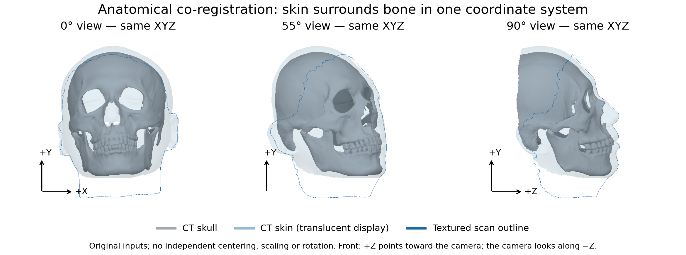
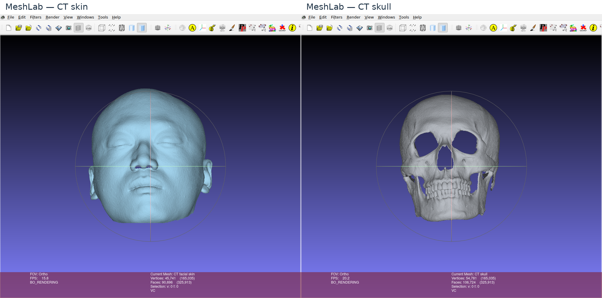

# Face and skull topology registration

This module converts an aligned textured face scan and CT-derived face/skull surfaces into meshes with consistent template topology. It retains the fitting objectives, topology operations and numerical defaults.

## Inputs

For your own subjects, keep input scans in a directory with these filenames:

```text
/path/to/private/data/<subject_id>/
  face_scan.obj
  face_scan.mtl
  face_scan.png
  face.obj
  skull.obj
```

`face_scan.obj` is the textured scanner face. `face.obj` and `skull.obj` are CT-derived surfaces. All three meshes must already share the same subject coordinate system and use the expected frontal orientation. OBJ material and texture references must resolve correctly. The pipeline does not provide initial rigid alignment between unrelated scan coordinate systems.

The example is provided at `data/input/sample_001/raw/` with all five files above: scanner face (64513 vertices), CT face (45741 vertices) and CT skull (54781 vertices). These are original inputs with different topologies, not the template-topology results. Other subjects are not included. Topology conversion does not anonymize geometry or establish permission to redistribute other data.

## Anatomical alignment and initial orientation

Anatomical co-registration means that the **same physical location has the same XYZ coordinates in every input mesh**. CT skin surrounds the skull; the scanner skin overlaps the CT skin over their shared facial region. It does not mean putting the skin and bone surfaces on top of one another, or independently moving each mesh's bounding-box center to the origin.



*CT skin is translucent here only to reveal the bone. All panels use the original coordinates and one shared view transform; the scanner outline shows its different acquisition coverage.*

Prepare the input face looking toward **+Z**, with the crown toward **+Y** and **+X to the right in a frontal display**. A frontal camera sits on +Z and looks along −Z. This is a computational frame, not a clinical horizontal-plane definition, and the display's X sign alone does not establish anatomical patient left/right. The [camera-axis illustration](https://github.com/microsoft/Deep3DFaceReconstruction/blob/master/images/camera.png) shows this convention schematically.

For independently acquired scanner and CT surfaces, first rigidly align scanner skin to CT skin using corresponding facial regions, then inspect the nose bridge, forehead and both cheeks from frontal and side views. Keep CT skin and CT skull together: if their frame changes, apply the **same** rotation, translation and unit conversion to both. Use one unit convention across all inputs. Export the applied transforms into the vertex coordinates. Do not independently resize the skull to the face, reflect one axis, or infer a unit conversion from separate bounding boxes. Acquisition coverage, expression and CT skin segmentation can differ even after rigid co-registration.

### Inspect in MeshLab

Create a MeshLab scene from your input surfaces:

```bash
python -m bfsm_topology.inspect_alignment \
  --ct-face data/input/sample_001/raw/face.obj \
  --skull data/input/sample_001/raw/skull.obj \
  --scan-face data/input/sample_001/raw/face_scan.obj \
  --output data/output/runs/alignment_inspection
```

For CT-only input, omit `--scan-face`. Open the generated `alignment.mlp` using **File → Open Project** in MeshLab. It contains separate skin/skull layers, all with identity layer matrices. Toggle their visibility in the layer panel; compare frontal, oblique and side views, and use wireframe to inspect the bone beneath the skin. A skull can be correctly positioned even when hidden by opaque skin.



*Actual MeshLab screenshots: only layer visibility changes between CT skin and CT skull; the camera and mesh coordinates stay fixed. The viewport crosshair is a trackball overlay, not an anatomical reference plane.*

The inspection command exports double-precision PLY coordinates and unchanged triangle indices so the scene also works with mesh editors whose OBJ importer rejects the source file. These are display copies without scan UV/materials; use the original OBJ/MTL/texture files for registration. The command **does not align** mismatched acquisitions and never writes the inputs. Changing only the MeshLab camera does not fix mesh alignment.

## Runtime assets and environment

Install the [registration environment](../../../environment/README.md). Obtain the [registration model and templates](../../../assets/README.md#registration-inputs) and [FAN/depth/SFD weights](../../../assets/README.md#detector-cache) using the asset guide's commands and paths.

The converter validates model arrays against the [BFM reference specification](../src/bfsm_topology/bfm_asset_spec.toml) and installs the matching landmark indices, templates and NICP configurations under `assets/external/registration/`. Set `VT_REGISTRATION_ASSETS` when using a different location. Strict CUDA requirements are in the [runtime guide](../../../common/README.md#deterministic-pytorch3d-cuda-rasterization).

Cite Paysan et al., *A 3D Face Model for Pose and Illumination Invariant Face Recognition* (AVSS 2009), and Guo et al., *CNN-based Real-time Dense Face Reconstruction with Inverse-rendered Photo-realistic Face Images* (TPAMI 2019), as required by the providers.

Run the following commands from the repository root.

## Run the original scan example

From the repository root, run all eight original numerical stages:

```bash
python -m bfsm_topology.demo \
  --input data/input/sample_001/raw \
  --output data/output/runs/sample_001/registration \
  --device cuda:0 --deterministic --seed 0
```

The raw input folder is never written. `standardized/` and `posed/` contain the original stage products. The corresponding result pair is `posed/topology_face.obj` (35709 vertices) and `posed/topology_skull.obj` (23207 vertices), in the same normalized template frame. `world/topology_face.obj` and `world/topology_skull.obj` restore the pair to the original scan frame and units; `coordinate_transform.npz` stores the shared reversible transform. All three input surfaces, their connectivity and the scan texture are checked against the saved stage products before accepting an explicitly reused run.

Reference results are in `data/output/reference/01_topology/sample_001/registration/`; commands write new results to `data/output/runs/` and do not consume those references implicitly. The [CT-only path](CT_ONLY.md) starts from the original CT face/skull, without requiring a textured scan.

## Lower-level stage commands

Inspect the interface:

```bash
python -B -m bfsm_topology.preprocess_pipeline.cli --help
python -B -m bfsm_topology.preprocess_pipeline.cli run --help
```

Run one subject:

```bash
python -m bfsm_topology.preprocess_pipeline.cli run \
  --data-root /path/to/private/data \
  --include SUBJECT_ID \
  --device cuda:0
```

Alternatively, `--data-root` can point directly to a subject directory containing any of the three input OBJ filenames. Without `--include`, the parent-directory form selects all immediate child directories. Missing requested subject names and empty selections raise errors before any stage starts.

For a strict repeatability comparison, run this command from the repository root after setting up the pinned PyTorch3D source headers described in `common/README.md#deterministic-pytorch3d-cuda-rasterization`:

```bash
VT_REGISTRATION_ASSETS=/path/to/legal/registration_assets \
VT_PYTORCH3D_SOURCE=/path/to/external/pytorch3d \
TORCH_EXTENSIONS_DIR=/path/to/private/cache/torch_extensions \
CUBLAS_WORKSPACE_CONFIG=:4096:8 \
python -m bfsm_topology.preprocess_pipeline.cli run \
  --data-root /path/to/private/data --include SUBJECT_ID \
  --device cuda:0 --deterministic --seed 0
```

`--deterministic` sets the recorded seed, strict PyTorch deterministic algorithms, fixed-order PyTorch3D CUDA backward, and disables cuDNN autotuning/TF32. The detector constructor's autotuning override is reset before fitting. It requires the pinned source headers and CUDA compiler for the first extension build. This backend also orders coarse triangle candidates by face index before the original fine rasterizer, so equal-depth triangles have a stable choice. Camera, shading, differentiation formulas, losses, fitting steps and learning rates are preserved. Native CUDA remains the default. In the standalone registration CLI, `--seed` applies only with `--deterministic`; native execution retains the original random-generator state and rasterizer behavior.

Use the same physical GPU and pinned environment for numerical regression comparisons. This option does not establish equivalence to unrestricted native CUDA; the separately recorded regression results describe the tested scope.

Select stages by repeating `--stage`:

```bash
python -m bfsm_topology.preprocess_pipeline.cli run \
  --data-root /path/to/private/data \
  --include SUBJECT_ID \
  --stage standardize --stage render \
  --device cuda:0
```

Selected stages always run in the fixed order below, regardless of argument order. Dependencies are not executed automatically; outputs required by later selected stages must already exist. Omitting `--stage`, or including `--stage all`, selects all eight stages.

## Stages and outputs

The table lists paths relative to the selected output directory. The example wrapper writes to its explicit `--output` path. The lower-level CLI defaults to `<subject>/output/`; `--output-root ROOT` instead writes to `ROOT/<subject>/`.

| Stage | Required inputs | Outputs relative to the selected output directory |
| --- | --- | --- |
| `standardize` | Original scanner face with texture, CT face and CT skull | `standardized/face_scan.obj` with texture, `face.obj`, `skull.obj`, `scale.npy` |
| `render` | Standardized textured scan | `standardized/render.png`, `render_depth.npy`, `render_depth_mask.npy` |
| `fit3dmm` | Rendered image, depth and mask; BFM assets | `standardized/render_coeffs.npy`, `render_mesh.obj`, `render_composed_img.jpg` |
| `pose` | Standardized meshes and fitted coefficients | `posed/face_scan.obj` with texture, `face.obj`, `skull.obj`, `render_mesh.obj` |
| `texture` | Posed fitted face and scan; standardized fitted vertex colors | `posed/face_scan_topology_points.obj` |
| `face_nicp` | Posed scan, fitted mesh and topology points | `posed/face_nicp.obj`, `topology_face.obj` |
| `skull_controls` | Posed topology face and skull; landmark indices | `posed/up_skull.npy`, `middle_skull.npy`, `down_skull.npy` |
| `skull_nicp` | Subject skull controls and posed skull; template mesh and controls | `posed/topology_skull.obj` |

Original input files are not overwritten. Stage outputs are written to fixed filenames and can be overwritten by subsequent runs.

Standardization uses the scanner face's bounding-box center and scale `2 / max(X extent, Y extent)`, applying the same transform to all three meshes. Pose normalization removes the fitted rigid transform. The lower-level stage outputs remain in this normalized coordinate space; `scale.npy` alone is not a complete inverse transform. The `bfsm_topology.demo` wrapper additionally stores the shared center, scale and fitted pose in `coordinate_transform.npz` and exports the world-space pair. It does not change fitting or NICP.

## Fitting defaults

The current model is BFM09. Coefficients contain 80 identity, 64 expression, 80 texture, 3 rotation, 27 illumination and 3 translation values. RGB rendering uses 224 × 224 pixels; depth uses 1024 × 1024. Camera distance is 10 and focal value is 1015, with FOV calculated for each render size.

`fit3dmm` runs the following seven optimization phases:

| Phase | Iterations | Optimized variables | Objective |
| --- | ---: | --- | --- |
| Initial rigid | `--first-rf-iters`, default 1000 | Rotation and translation | Landmark loss only |
| Initial non-rigid | `--first-nrf-iters`, default 500 | Identity, expression, texture, illumination, rotation, translation | `_nonrigid_loss`: landmarks, RGB and regularization |
| Rigid depth | Fixed 500 | Rotation and translation | Landmark loss plus `100 / 10 × depth_loss` |
| Non-rigid depth 1 | Fixed 1000 | All fitted variables | `_nonrigid_loss` plus `100 / 1 × depth_loss` |
| Non-rigid depth 2 | Fixed 1000 | All fitted variables | Blended landmark weights; depth weight `100 / 0.1` |
| Non-rigid depth 3 | Fixed 1000 | All fitted variables | Emphasized landmark weights; depth weight `100 / 0.05` |
| Non-rigid depth 4 | Fixed 1000 | All fitted variables | Emphasized landmark weights; depth weight `100 / 0.03` |

Both `--rf-lr` and `--nrf-lr` default to `1e-2`. The last phase uses `--nrf-lr × 0.1`. The initial rigid phase does not optimize lighting or texture and does not use an RGB objective. The default total is 6,000 iterations; changing the two exposed iteration flags does not change the five fixed later phases.

The non-rigid objective weights are landmark `100`, RGB `1.6`, identity L2 `1e-3`, expression L2 `0.8e-3`, texture L2 `1.7e-6`, and reflectance `1`. The depth loss averages masked squared depth differences over the full depth array. Later emphasized landmarks are `36:43`, `48:60`, and `31/33/35`; these slices describe the implementation exactly.

## Topology and NICP defaults

Texture-stage geometry uses the nearest scanner vertex. Colors use forward-normal ray hits, then reverse-normal rays for misses; if both miss, fitted vertex colors remain. The optional Python geometry mode `ray` is not the CLI default. Final face output keeps NICP geometry while transferring colors.

Both face and skull NICP first align control points with a similarity transform, then optimize one affine transform per template vertex. Internal normalization uses vertex means and the maximum XYZ bounding-box extent. The vertex term excludes boundary vertices and correspondences at distances of 0.04 or more in this internal space. The optimizer is AdamW with learning rate `1e-4` and `amsgrad=True`.

The default `assets/external/registration/config/fine_grain.toml` (or `config/fine_grain.toml` under `VT_REGISTRATION_ASSETS`) specifies 150 outer iterations and 50 inner iterations, except the first outer iteration uses 100 inner iterations. Stiffness weights are `[50,20,5,2,0.8,0.5,0.35,0.2]`; landmark weights are `[5,2,0.5,0,0,0,0,0]`; milestones are `[50,80,100,110,120,130,140]`; Laplacian weight is `250`. Schedule changes take effect after the corresponding milestone iteration. `--nicp-config PATH` can select the supplied coarse configuration or another compatible TOML/JSON configuration.

Skull controls use three ray targets derived from the face landmarks and require a 35,709-vertex face mesh with the expected vertex order. Missing intersections are marked `[-1,-1,-1]` and corresponding control pairs are excluded before NICP. The skull template's face connectivity becomes the output skull connectivity.

## External edited skull plan

Use this entry after preparing a skull edit in a separate tool. Supply a registered 35,709-vertex preoperative face and an external Plan OBJ in the **same canonical coordinate frame**. An original/world-space Plan must first receive the same `RegistrationTransform.to_canonical` transform as the registered subject; do not independently center or scale it.

```bash
python -m bfsm_topology.plan \
  --face results/registration/posed/topology_face.obj \
  --plan inputs/Plan_canonical.obj \
  --output results/plan_registration \
  --device cuda:0 --deterministic --seed 0
```

Use `--device cpu` for CPU execution. The output must be new or empty and outside both input directories; existing results are not overwritten. This entry copies the inputs, then calls the original three-ray skull-control computation and skull NICP with unchanged defaults. It does not generate osteotomy lines, bone segments or surgical rotations. `--nicp-config` and `--skull-template-dir` have the same meanings as in the registration pipeline.

| Output | Meaning |
| --- | --- |
| `topology_Plan.obj` | Main result: Plan represented on the fixed 23,207-vertex BFSM skull topology, for the postoperative predictor |
| `topology_face.obj` | Unchanged copy of the supplied preoperative topology face |
| `skull.obj` | Unchanged copy of the external Plan target, **not** the preoperative skull |
| `up_skull.npy`, `middle_skull.npy`, `down_skull.npy` | Three ray-control arrays computed against that Plan target |

The external target may have different connectivity, including tool-created cut surfaces. The returned fixed template does **not** preserve added cut faces or independently disconnected bone pieces. Inspect its fit, especially near large movements, gaps and missing ray intersections, before using it with the original preoperative face/skull pair. Bone–face collision detection or correction is not applied. See the [postoperative module](../../04_postoperative/README.md) for the subsequent prediction and surface-transfer workflow.

## Custom skull template pair

When building an institution-specific model, we recommend selecting an existing, natural-looking mean 3D face–skull pair as the reference template. Its existing mesh topology defines the target topology; each individual case is registered to that reference before model construction.

For the face, we recommend following [our face-registration workflow](../README.md) to obtain the 35,709-vertex topology and corresponding landmark indexing used by this implementation. For the skull, use the selected mean skull mesh directly and retain its own topology; it does not need conversion to the supplied 23,207-vertex skull topology. Keep the face and skull anatomically aligned in one coordinate frame, and use the resulting template topology and matching face–skull pairing metadata consistently when constructing the institution's models.

Export controls from a compatible face template and a skull template:

```bash
python -m bfsm_topology.preprocess_pipeline.cli make-template \
  --output-dir /path/to/private/template \
  --face-template /path/to/compatible_face.obj \
  --skull-template /path/to/skull_template.obj
```

The exported directory contains `skull_template.obj`, `up_skull_template.npy`, `middle_skull_template.npy`, and `down_skull_template.npy`. Pass it with `--skull-template-dir /path/to/private/template` when running `skull_nicp`. Subject controls still come from the subject's `skull_controls` stage.

## Rasterization and repeatability

Coarse raster bins reserve capacity for every mesh triangle so candidate faces are not discarded. GPU memory requirements increase with mesh size.

With `--deterministic`, equal-depth candidates are ordered by packed face index and gradient contributions use a fixed reduction order. Only the common padding tail is removed before fine rasterization; valid candidates are retained. Native mode uses upstream PyTorch3D tie handling. See the [backend guide](../../../common/README.md#deterministic-pytorch3d-cuda-rasterization) for requirements and memory use.

## Batch and input behavior

FaceAlignment runs on the selected device. Every subject starts from zero fitting coefficients; the detector and immutable BFM assets are reused across subjects. Registration uses BFM09; facial FLAME reconstruction is provided by module 5.

A complete scan-to-topology run requires the source surfaces, supplied for the example under `data/input/sample_001/raw/`. To use another collection of scans, provide its aligned surfaces and follow the applicable data-use and redistribution terms.
