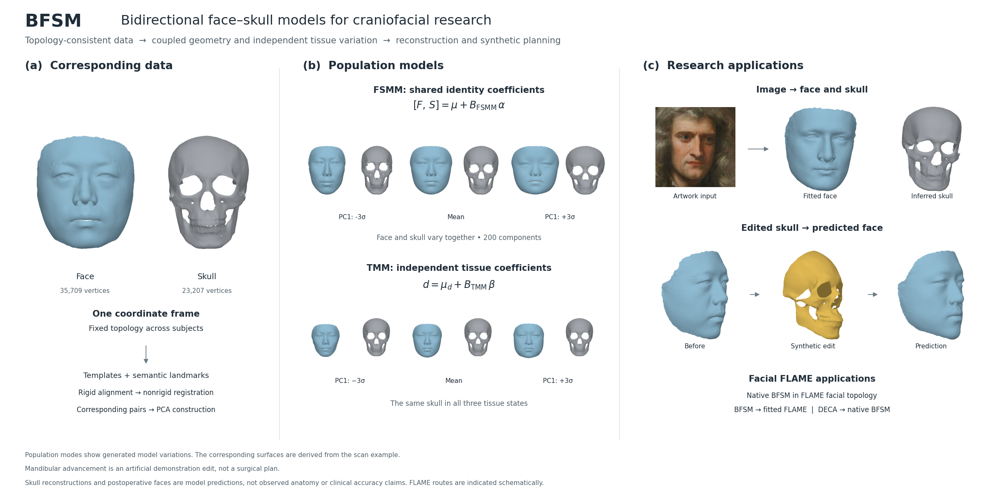
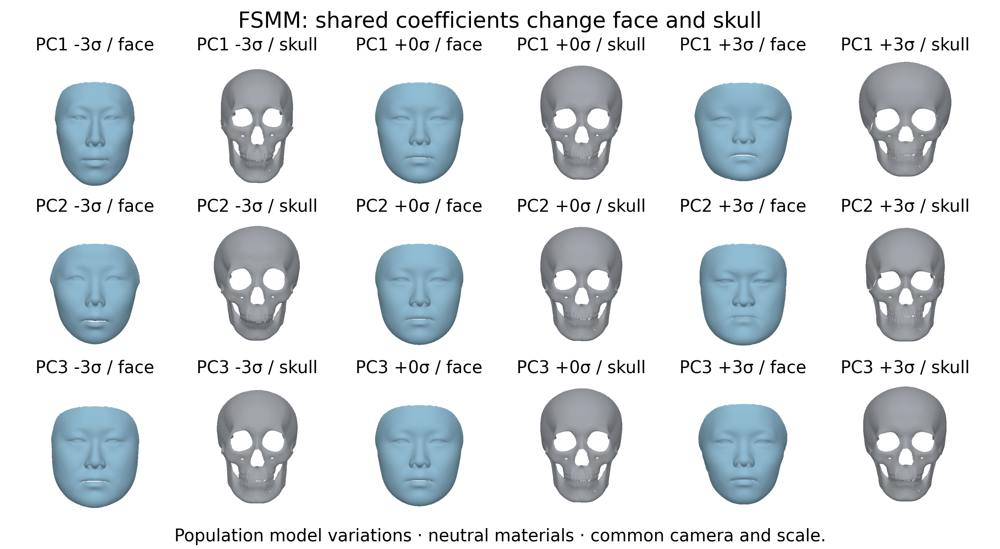
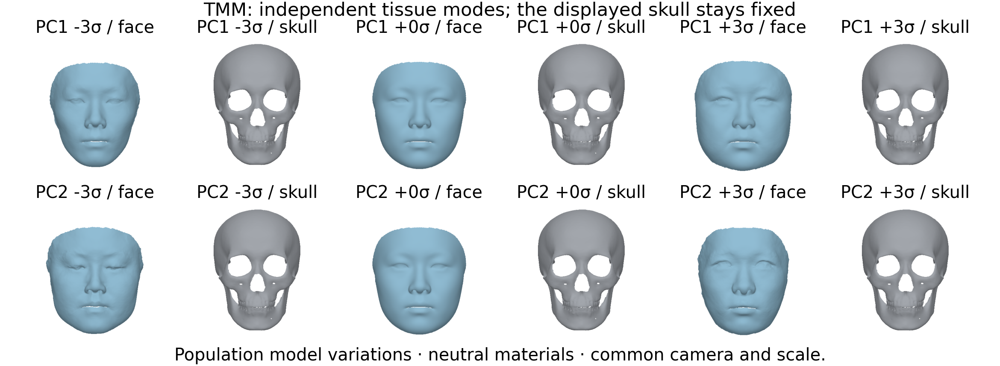
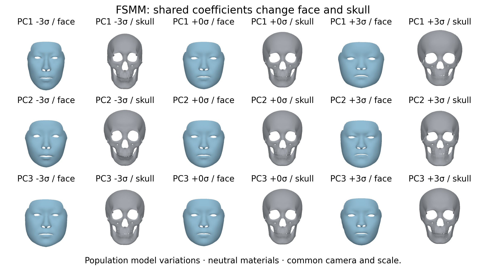
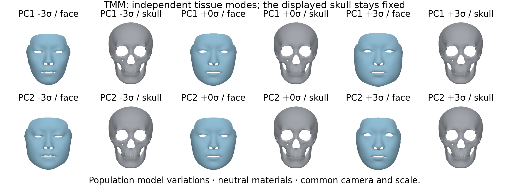
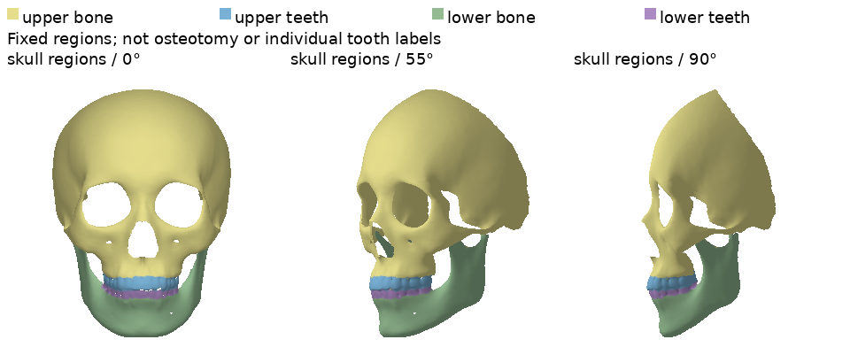
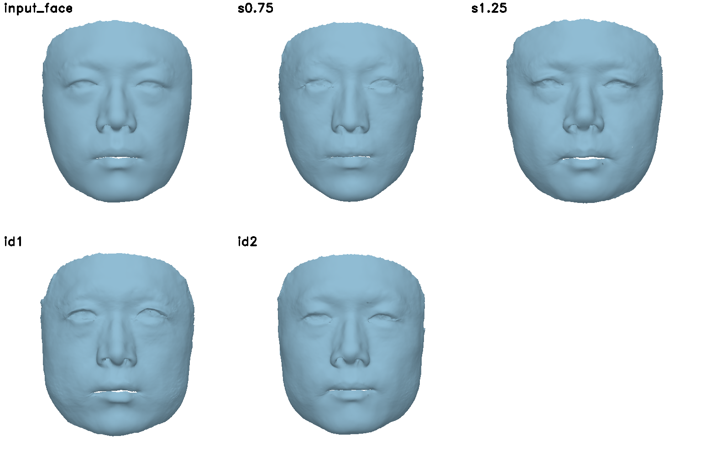

# 2. Shared shape and independent tissue visualization

[Project home](../../README.md) · [Environment](../../environment/README.md) · [Assets](../../assets/README.md)

Install the shared core and this workflow in your configured environment from the repository root:

```bash
python -m pip install -e . -e modules/02_morphable_models
```

## BFSM: 3D Bidirectional Face-Skull Morphable Model

By [Zidu Wang](https://scholar.google.com/citations?user=7zD5f0IAAAAJ&hl=zh-CN&oi=ao), [Meng Xu](https://openreview.net/profile?id=~Meng_Xu15), [Miao Xu](https://scholar.google.com/citations?user=eHbkeRsAAAAJ), [Hengyuan Ma](https://scholar.google.com/citations?user=nrnLH_sAAAAJ), [Jiankuo Zhao](https://scholar.google.com/citations?user=uL9EQoAAAAAJ), [Xutao Li](https://openreview.net/profile?id=~Xutao_Li4), [Xiangyu Zhu](https://xiangyuzhu-open.github.io/homepage/) and [Zhen Lei](http://www.cbsr.ia.ac.cn/users/zlei/).

[Paper: arXiv:2509.24577](https://arxiv.org/abs/2509.24577)



The Face–Skull Morphable Model (FSMM) couples face and skull through shared identity coefficients. The independent Tissue Morphable Model (TMM) describes soft-tissue variation around a fixed skull. The default models each contain **200 geometry components**; see [model formats](../../assets/README.md#geometry-model-formats).

The overview shows the registered example, population modes, Newton reconstruction and a synthetic mandibular edit.

## Principal components

This module follows topology construction and PCA construction: **FSMM changes face and skull together**, whereas **TMM changes soft-tissue vectors while the displayed skull is fixed**.





The figures show population means and principal-component variations of the 200-component geometry models. FSMM shows the first three Principal Components (PCs); TMM shows the first two. Each basis is already scaled by its standard deviation, so coefficients `−3/0/+3` mean `−3σ/mean/+3σ`; do not multiply the basis by its standard deviation again.

[Offline 3D viewers](../../assets/README.md#small-region-labels-and-generated-viewers) support rotation, zoom and exact discrete state changes. The viewers contain seven FSMM states and five TMM states. Each selection displays precomputed geometry. In TMM, paired target points are constructed from fixed skull minus the independent tissue vector, then the 5000-step geometry fitting produces the face. All displayed TMM skull vertices remain identical.

To regenerate figures and geometry with the configured Torch and visualization dependencies:

```bash
python -m bfsm_models.modes --fsmm assets/models/fsmm_200.npz \
  --tmm assets/models/tmm_200.npz --output data/output/runs/model_modes --device cpu
```

Use a new output directory for geometry generation. `--sigma 3` sets the coefficient magnitude; `--generate-only` skips figures. To render a completed geometry directory again, use `--render-existing` with the same `--output`. The bundled reference mode directory contains figures only, so generate geometry before using this option. CPU execution includes five full TMM fits and can take longer than CUDA.

### TMM face fitting

The TMM vector basis represents paired tissue displacements, not face vertices or FSMM coefficients. For each state, targets are computed as `fixed_skull[pairs[:, 1]] - tissue_vector`, with tissue scale fixed at 1. All original pair records, including repeated face indices, enter the original five-stage fit:

| Stage | Iterations | Learning rate | Identity optimized |
| --- | ---: | ---: | --- |
| Rigid 1 | 500 | 0.01 | No |
| Rigid 2 | 500 | 0.005 | No |
| Nonrigid 1 | 500 | 0.01 | Yes |
| Nonrigid 2 | 1500 | 0.005 | Yes |
| Nonrigid 3 | 2000 | 0.0001 | Yes |

Every stage optimizes rotation, scale and translation. The exported face is decoded from the final optimized coefficients; the auxiliary fit's predicted skull is discarded. Paired endpoints need not be satisfied exactly: each TMM `state.npz` retains the target points, fitted face and parameters for residual inspection.

### Outputs and rendering

- `fsmm_modes.png` / `.pdf` and `tmm_modes.png` / `.pdf`: population-mode figures.
- `fsmm_interactive.html` and `tmm_interactive.html`: offline rotation, zoom and state selection, with full-resolution geometry and embedded Plotly. The generated viewers include `PLOTLY_LICENSE.txt` alongside them.
- `fsmm/<state>/` and `tmm/<state>/`: untextured face/skull OBJ files and state NPZ files containing generated coefficients and geometry.

Static panels share an orthographic camera and scale within each figure, viewing from +Z with +X screen-right and +Y screen-up. PNG/PDF rendering uses per-pixel depth, area-weighted smooth vertex normals and frontal lighting, without mesh decimation. Coefficients `−3/+3` are selected model variations, not confidence bounds or guaranteed anatomical extremes. Rendering uses NumPy, PyTorch, trimesh, matplotlib, Pillow and Plotly from the configured environment.

## FLAME-domain principal components

After preparing the native FLAME models in [module 5](../05_applications/README.md), install its decoder alongside this module:

```bash
python -m pip install -e modules/05_applications
python -m bfsm_models.flame_modes \
  --fsmm assets/models/flame_fsmm_200.npz \
  --tmm assets/models/flame_tmm_200.npz \
  --output data/output/runs/flame_modes
```

The command exports OBJ/NPZ states and PNG/PDF/interactive HTML figures under `fsmm/` and `tmm/`. FSMM displays three components on the 1,657-vertex face. For each of the five TMM states, the command uses all original face–skull pair observations and the same 5,000-step face fitting as the standard-topology demonstration, then projects the fitted face into the full 1,657-vertex / 3,144-triangle FLAME facial patch. The displayed skull stays fixed. Both original-topology models and their matching FLAME versions are required; `--source-fsmm` and `--source-tmm` select custom original models. The mapped TMM's 1,088-point support describes its directly represented tissue vectors, not the coverage of the final fitted face. The coefficients are `−3/0/+3` by default (`--sigma` sets their magnitude); `--device cuda:0` selects CUDA for fitting.





## Fixed-topology skull regions



The original template labels partition the 23207 skull vertices into upper bone (16678), upper teeth (1154), lower bone (4817), and lower teeth (558). This illustrates the consistent-topology subregion visualization described in [BFSM, Figure 4(a)](https://arxiv.org/html/2509.24577v1#S3.SS3). The figure is rendered from the model mean.

```bash
python -m bfsm_models.regions --model assets/models/fsmm_200.npz \
  --output data/output/runs/skull_regions --render --device cpu --size 320
```

To display the same labels on the registered example instead:

```bash
python -m bfsm_models.regions \
  --skull data/output/reference/01_topology/sample_001/registration/posed/topology_skull.obj \
  --output data/output/runs/sample_001_regions --render --device cpu --size 320
```

The command writes the unchanged full geometry with vertex colours, four region-only OBJ files, and an optional three-view figure. Region-only files keep triangles whose three vertices all belong to that region; they are visualization extracts, not watertight surgical cuts. The small bundled `modules/02_morphable_models/src/bfsm_models/skull_regions.npz` contains only boolean labels, a vertex count and the required triangle-topology hash. It contains no source-template coordinates. NumPy/trimesh suffice for OBJ export; rendering additionally uses the documented Torch/PyTorch3D environment.

These four coarse template regions are not individual tooth labels, maxillary osteotomy segments or distal/proximal mandibular segments. They do not establish missing anatomy. They are an optional visualization aid, not a prerequisite for editing a skull in external geometry tools.

## Original patient-conditioned tissue variations

This is the original tissue demonstration, distinct from the population mode figure above and from surgery:

```bash
python -m bfsm_models.tissue \
  --face_obj_path data/output/reference/01_topology/sample_001/registration/posed/topology_face.obj \
  --skull_obj_path data/output/reference/01_topology/sample_001/registration/posed/topology_skull.obj \
  --fsmm assets/models/fsmm_200.npz --tmm assets/models/tmm_200.npz \
  --output_dir data/output/runs/tissue --device cuda:0 --seed 0
```

The input pair's skull-minus-face displacement is the base tissue state. The `s0.75` and `s1.25` variants scale it by 0.75 or 1.25; `id1` and `id2` add seeded TMM basis perturbations. The skull stays fixed, and each resulting target set undergoes the same five-stage, 5000-step face fitting described above.

`--variant s0.75` selects one variation; repeat the option to select more. By default all four run. Geometry-only outputs use neutral face colour. Optional `--texture-variations` requires separately obtained FSMM texture weights and input vertex colours; these weights are not included in the supplied geometry models. Each result saves tissue coefficients, scale, targets, fitted coefficients and face vertices. `--legacy-cache` selects the original pre-final-update export instead of the default final optimized state.

Reference results for the four variations (`s0.75`, `s1.25`, `id1`, `id2`), each fitted for 5000 steps, are in `data/output/reference/02_models/sample_001/tissue/`. The labels `id1/id2` denote sampled tissue coefficients, not patient identities. The image profile provides the optional grid renderer; `--no-render` omits that preview while preserving fitting.



Geometry previews use the same light-blue face and silver-gray skull materials throughout the project. CPU tissue previews use the compiled Cython renderer described in the [image guide](../03_image_reconstruction/README.md#environment-and-assets); CUDA previews retain the nvdiffrast path.
