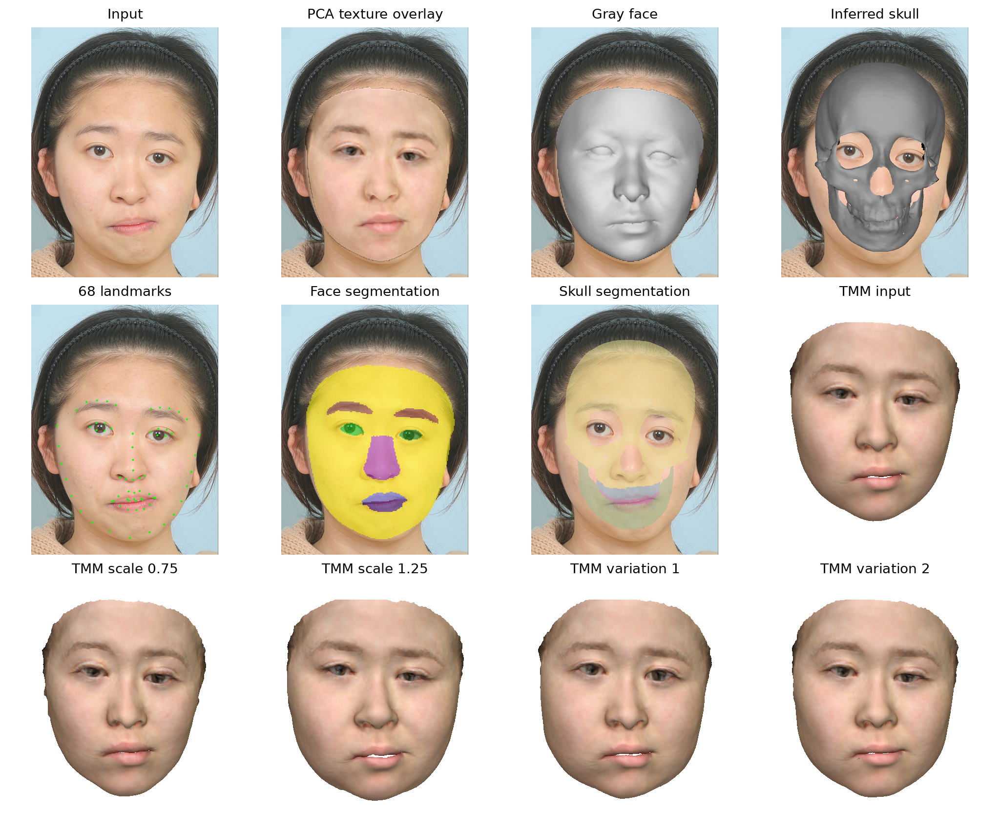

# 3. Image-based face, skull and tissue reconstruction

[Project home](../../README.md) · [Environment](../../environment/README.md) · [Assets](../../assets/README.md)

Start with one photograph or artwork. The original face network reconstructs the expression-bearing face; a shared-coefficient FSMM fit then produces a corresponding face and inferred skull. No CT or 3D scan is required. The inferred skull is a model prediction, not a measured CT surface.

## Environment and assets

Install from the repository root in the configured [image environment](../../environment/README.md):

```bash
python -m pip install -e . -e modules/02_morphable_models -e modules/03_image_reconstruction
```

Download the [external image files](../../assets/README.md#image-reconstruction-files) to `assets/external/image/` and install `fsmm_200.npz` under `assets/models/`. Tissue variations additionally require `tmm_200.npz`. Provider model and checkpoint terms apply separately. RetinaFace is the default detector; optional MTCNN requires its separately installed `mtcnn` and TensorFlow dependencies.

The image/all setup builds the shared Cython renderer. For a manual CPU build, run `python setup.py build_ext -i` from `common/src/bfsm_core/rendering/cython_renderer`. CUDA rendering uses nvdiffrast.

## Reconstruct your image

Run commands from the repository root:

```bash
python -m bfsm_image.demo_reconstruction \
  --inputpath path/to/image.png --savepath data/output/runs/image \
  --assets assets/external/image --fsmm assets/models/fsmm_200.npz \
  --device cuda:0 --iscrop 1 --detector retinaface --seed 0
```

The input may be one image or a directory of PNG/JPG/JPEG files (case-insensitive extensions) with distinct filename stems. Cropping retains the original first-face selection and 224×224 fallback if detection fails. Use `--iscrop 0` only for an already prepared 224×224 input. The CLI's unchanged default image is the bundled Newton portrait.

The five original FSMM fitting stages use 500/500/500/1500/2000 updates and their original learning rates. The 200-component release is a separate model version from the original 322-component model. 

### Reconstruction outputs

Files are written to `--savepath/<image stem>/`:

| File | Meaning |
| --- | --- |
| `network_input.png` | Exact detected/cropped network input |
| `<stem>.png` | Input, PCA-textured face overlay, gray face, inferred skull, 68 landmarks, face segmentation and skull segmentation |
| `<stem>.npy` | Projected landmark coordinates and enabled segmentation labels in original image pixels |
| `<stem>_pcaTex.obj` | Expression-bearing network face with BFM colors and lighting; `--useTex 1` |
| `<stem>_extractTex.obj` | Same network geometry with image-sampled vertex colors; `--extractTex 1` |
| `<stem>_fsmm_face.obj` | Face fitted with the shared FSMM geometry coefficients |
| `<stem>_skull.obj` | Skull decoded with those same FSMM coefficients |
| `reconstruction.npz` | Reconstruction arrays and fitted coefficients |

The default preview shows seven panels in that order. Face segmentation uses the eight [3DDFA-V3](https://github.com/wang-zidu/3DDFA-V3) template regions (eyes, eyebrows, nose, upper/lower lips and skin), projected with visibility handling. Skull segmentation projects the four fixed upper/lower bone and tooth regions onto the inferred skull. These are mesh-label projections, not independent image-parsing predictions. `--seg_visible 0`, `--skull-seg 0` or `--ldm68 0` disables the corresponding output; `--seg 1` additionally shows each face region without visibility filtering. Landmark exports follow the enabled landmark flags. If both texture exports are disabled, no network-face OBJ is written; the FSMM face and skull are still exported. No duplicate `<stem>_face.obj` is produced. The fitted face carries the network's per-vertex BFM colors and lighting, held by correspondence rather than recomputed after fitting. OBJ export undoes the camera-depth conversion (`10 - z`); the saved FSMM scale, rotation and translation remain in its model coordinates. The inverse image crop is not a 3D registration transform. Exports use the final optimized coefficients.

## Image-conditioned tissue variations

This entry point reconstructs the image automatically, then keeps its inferred skull fixed while changing soft tissue. It needs only the image and installed model assets:

```bash
python -m bfsm_image.tissue \
  --image path/to/image.png --output data/output/runs/image_tissue \
  --device cuda:0 --seed 0
```

The original reconstruction still runs its complete 5000-step fit. Its paired FSMM face/skull supply the original subject-conditioned tissue vectors, `d = skull[pair_skull] - face[pair_face]`. Before applying the TMM basis, the reconstructed pair is transformed back through its saved scale, rotation and translation to the canonical FSMM frame. The existing [tissue workflow](../02_morphable_models/README.md#original-patient-conditioned-tissue-variations) then runs all original paired observations, including repeated face indices, and all five fitting stages for **each** variant:

| Variant | Target tissue vectors |
| --- | --- |
| `s0.75` | Input tissue vectors scaled by 0.75 |
| `s1.25` | Input tissue vectors scaled by 1.25 |
| `id1`, `id2` | Independently sampled TMM coefficients added to the input tissue vectors |

Each variant uses 500/500/500/1500/2000 fitting updates. These are tissue variations around the reconstructed individual, not postoperative predictions or different patient identities. The fitted faces are then returned through the same similarity to the image reconstruction frame; the same inferred skull stays fixed. Input per-vertex face colors are retained, corresponding to the original zero texture-coefficient change; no FSMM texture PCA is needed or evaluated.

`summary.png` combines seven reconstruction panels and five TMM states into a labelled 12-panel figure. `reconstruction/<image stem>/` contains the reconstruction files above. `tissue/` contains the original image-frame `input_face.obj` and `input_skull.obj`, four fitted image-frame OBJ files, `_parameters.npz` arrays, image-frame `_tissue_points.ply` target clouds, `reconstruction_frame.npz`, and `change_tissue.png`. `tissue/canonical/` retains the original fitter inputs and outputs. The root parameter archives retain canonical fit coefficients and targets together with `image_scale`, `image_rotation`, `image_translation`, `image_face_vertices` and `image_target_points`; apply the saved similarity when replaying them in the image frame. `--no-render` skips the tissue comparison grid and combined summary. No existing result is implicitly reused.

## Example 1

```bash
python -m bfsm_image.tissue \
  --image data/input/image_clinical/1.png \
  --output data/output/runs/image_clinical --device cuda:0 --seed 0
```




## Example 2

```bash
python -m bfsm_image.tissue \
  --image data/input/image_portrait/2.jpg \
  --output data/output/runs/image_portrait --device cuda:0 --seed 0
```


The Newton reconstruction figure uses presentation-only crops; the full input and reconstruction are unchanged. [Image sources and attribution](../../data/input/IMAGE_SOURCES.md) cover both examples. Complete reference reconstructions are under `data/output/reference/03_image/`.

The [DECA frontend](../05_applications/README.md) is a separate image-based reconstruction route. [Postoperative prediction](../04_postoperative/README.md) uses an edited skull rather than tissue coefficient variation.
