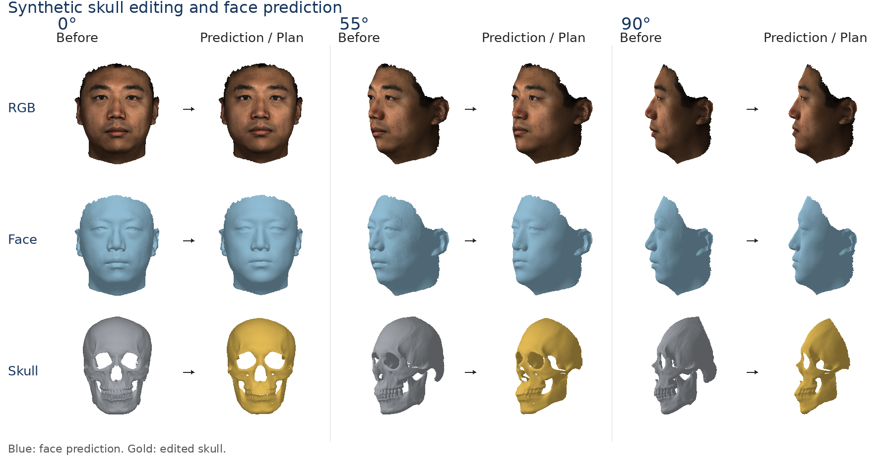
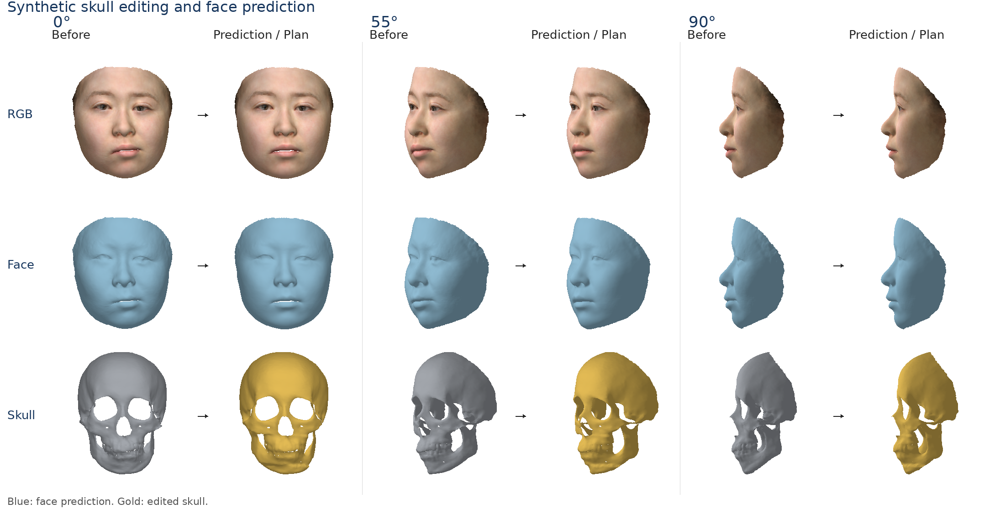
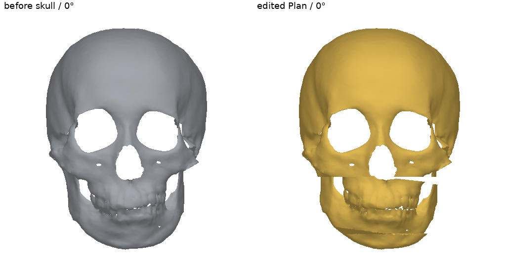
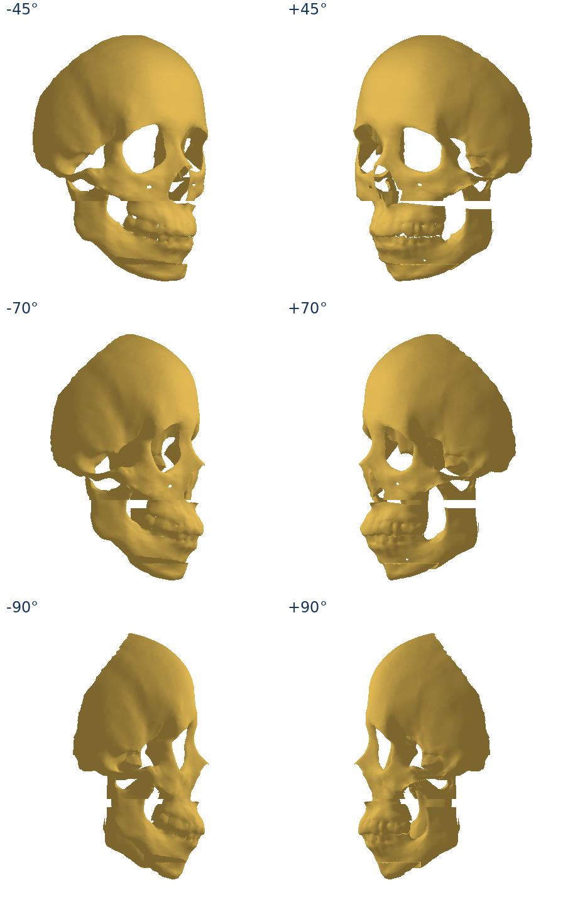

# 4. Postoperative software demonstrations

[Project home](../../README.md) · [Environment](../../environment/README.md) · [Assets](../../assets/README.md)

Install the shared core and this workflow in your configured environment from the repository root:

```bash
python -m pip install -e . -e modules/04_postoperative -e modules/01_topology_and_modeling -e modules/03_image_reconstruction
```

Two input routes share the original tissue transport and FSMM face fitting, with separate geometric edit inputs. The scan route uses ARAP for measured-surface detail transfer; the photo route directly exports the predicted postoperative FSMM face. Use the complete environment, or registration capabilities for the scan route and both image and registration capabilities for the photograph-plus-external-Plan route, with the assets listed in each frontend guide. Rendering requires PyTorch3D; `--no-render` skips comparison grids only, not reconstruction or prediction.

## Original 3D textured face and CT skull

The supplied [sample_001 example](../../data/input/sample_001/README.md) begins with its original `face_scan.obj` and `skull.obj`, together with the scan material/texture and aligned CT face. It runs all eight registration stages before editing and predicting. The final face has the original scan's 64513 vertices and 128493 triangles, with its UV mapping and material preserved.

```bash
python -m bfsm_postoperative.demo scan --example data/input/sample_001 \
  --output data/output/runs/postoperative_scan --device cuda:0 --deterministic --seed 0
```



*Each view pairs Before with a predicted face or edited input skull. Rows show scan texture, blue face geometry, and gray original/gold edited skull. The figure compares before and predicted surfaces at frontal, 55° oblique and 90° profile views.*

### Use your own edited skull mesh

You can supply an edited skull OBJ directly with `--plan`; no edit-description TOML is required. First register the original case to obtain its canonical frame:

```bash
python -m bfsm_topology.demo \
  --input data/input/sample_001/raw \
  --output data/output/runs/scan_prepare \
  --device cuda:0 --deterministic --seed 0
```

Edit `data/output/runs/scan_prepare/posed/topology_skull.obj` in your mesh tool and save a separate `path/to/scan_Plan_canonical.obj`. You can instead edit the detailed `posed/skull.obj` from the same run. Keep the original before meshes unchanged and preserve their common coordinates, orientation and scale. Then reuse that completed registration when predicting:

```bash
python -m bfsm_postoperative.demo scan \
  --example data/input/sample_001 \
  --plan path/to/scan_Plan_canonical.obj \
  --registration-dir data/output/runs/scan_prepare \
  --output data/output/runs/postoperative_scan_plan \
  --device cuda:0 --deterministic --seed 0
```

For your own scan, replace `data/input/sample_001` with your case directory and use its `raw/` folder in the preparation command. See [registration inputs](../01_topology_and_modeling/docs/REGISTRATION.md) for the required surfaces. The Plan may have different vertex counts and connectivity; the [external Plan requirements](#external-plan-requirements) apply. The scan route finishes with ARAP on the original textured face scan.

## Photograph input: general route, no CT

The image frontend reconstructs and fits a same-topology FSMM face/skull pair. The before face is module3's `*_fsmm_face.obj` (canonical `before_face.obj`), paired with `*_skull.obj`. The network `*_pcaTex.obj`/`*_extractTex.obj` shares topology but has different geometry; it is not the before surface used here. Its shared pose/scale are removed before editing. Supply a tool-edited skull Plan in this canonical frame; original ray initialization and NICP return its fixed-topology representation. The original postoperative predictor directly exports the predicted postoperative 35709-vertex FSMM face, with no ARAP or network-surface transfer.

First prepare the canonical pair from your photograph:

```bash
python - <<'PYTHON'
from bfsm_postoperative.image_input import prepare_image
prepare_image('path/to/photo.png', 'data/output/runs/photo_prepare', device='cuda:0')
PYTHON
```

This writes `data/output/runs/photo_prepare/before_face.obj`, `before_skull.obj` and `image_frame.npz`. Edit `before_skull.obj` in your external mesh tool, preserving its canonical coordinates and the unchanged before files. Save the edited mesh separately as `path/to/Plan_canonical.obj`; do not independently center or scale it.

Then predict using that Plan and the same validated reconstruction:

```bash
python -m bfsm_postoperative.demo image --image path/to/photo.png \
  --plan path/to/Plan_canonical.obj \
  --reconstruction-dir data/output/runs/photo_prepare/image_reconstruction/photo \
  --output data/output/runs/postoperative_photo --device cuda:0 --seed 0
```

Here `photo` is the input filename stem (`photo.png` → `photo`). The explicit reconstruction directory validates and reuses the completed 5000-step frontend, keeping the Plan paired with the same reconstructed geometry. Omitting this flag reruns the frontend.

The `--plan` command uses your mesh directly as the registration target, without a textual edit definition. Each Plan must match that photograph's reconstructed canonical frame. The photo route exports the predicted FSMM face directly, without ARAP.

The [example photograph](../../data/input/image_clinical/1.png) and its prepared Plan provide a reproducible example:

```bash
python -m bfsm_postoperative.demo image --image data/input/image_clinical/1.png \
  --output data/output/runs/postoperative_image --device cuda:0 --seed 0
```



*The face is the predicted FSMM surface. Both skulls are inferred from the photograph.*

[Geometry-only comparison](../../data/output/reference/04_postoperative/image_clinical/preview_geometry/comparison.png).

## External Plan requirements

Both `scan` and `image` accept `--plan path/to/Plan_canonical.obj`. This overrides the configured edits. Prepare the Plan for the same case, in the canonical frame produced by the corresponding preparation command above. A different patient's skull or a mesh independently centered, rotated or rescaled is not an aligned editing input. If editing in original world coordinates, transform the result to the saved canonical frame before passing it here. Convert other mesh formats to a finite, nonempty triangular OBJ first.

The input Plan can have a different vertex count, vertex order and triangle connectivity, including cuts and added faces. Both routes run the original ray initialization and NICP to approximate its surface with the installed 23,207-vertex BFSM skull topology, then perform tissue transport and face prediction. The predictor does not directly consume arbitrary topology. Large edits, missing surface coverage or difficult geometry can give a poor approximation; inspect `plan_registration/<case>/topology_Plan.obj` against your input Plan before interpreting the prediction. New cut/bridge faces and disconnected segment topology are not preserved individually in the fitted template. The original Plan is retained separately in the output frame.

To evaluate several mesh Plans in one run, optionally put their paths in a TOML file:

```toml
[edits.plan_a]
kind = "external_plan"
plan = "/absolute/path/to/Plan_A_canonical.obj"

[edits.plan_b]
kind = "external_plan"
plan = "/absolute/path/to/Plan_B_canonical.obj"
```

Use `--config path/to/plans.toml` in either route instead of `--plan`. Relative Plan paths are resolved from the TOML file's directory. The supplied `image_demo.toml` is bound to its reference photograph and model; use your own Plan or configuration for another case.

## External editing input





The [case configuration](configs/image_demo.toml) selects `Plan.obj`. Preparation actually cuts and separates upper dental-bearing, lower dental-bearing and chin regions. The upper/lower regions rotate approximately −6.573°/−8.185° about canonical Z; the chin is centered independently. The Plan changes topology. A manually built 262-triangle bridge closes the lower–chin opening: these faces are synthetic software geometry, not observed patient bone. Coordinates are model units, not verified millimetres.

Original template upper/lower region annotations assisted this example's preparation and tooth-region checks. The generic editor accepts independent segment OBJ files or an external Plan; those annotation arrays are not its runtime dependency. This input is a software geometry demonstration, not the original clinical operation or validated occlusion.

The supplied editing input can also be regenerated from the independent [cut pieces and transform configuration](../../data/input/image_clinical/plan_edit/README.md):

```bash
python -m bfsm_postoperative.plan_edit --config data/input/image_clinical/plan_edit/edit.toml \
  --output data/output/runs/Plan.obj
```

This applies the supplied rigid transforms and bridge faces; it does not automatically discover clinical cuts. The default prediction command reads the already supplied `data/input/image_clinical/Plan.obj`, so this preparation need not be repeated for each prediction run.

The photograph prediction entry runs reconstruction, original [external-Plan registration](../01_topology_and_modeling/docs/REGISTRATION.md#external-edited-skull-plan) and direct FSMM prediction. A differently connected Plan cannot enter the predictor directly. NICP produces its required 23207-vertex `topology_Plan.obj`; that fitted template does not preserve the input's added cut/bridge faces as separate pieces. Inspect both input Plan and fitted template.

## Shared parameters and outputs

The default demonstrations use FSMM200 and seed 0; `--model` and `--seed` can select alternatives. Both routes share the same four fitting stages (200/200/600/1000 iterations; learning rates 0.001/0.0005/0.001/0.0005), the same region weights (2.4/0.4/0.4/0.4/0.4/1.2). Only the scan route then applies 10 ARAP iterations. The scan [configuration](configs/scan_demo.toml) controls three bilateral advancement/retraction/narrowing edits; the HFM configuration selects one external cut Plan. Editing inputs differ while prediction parameters match. Both include an unchanged-skull fitting control. The frontends keep their own original schedules; the external Plan uses the original full ray/NICP registration.

The following directories describe a complete new run. Bundled reference examples retain only selected results; see the [input/output guide](../../data/README.md).

| Output directory | Meaning |
| --- | --- |
| `registration/` or `reconstruction/` | Original-input frontend and canonical face/skull pair |
| `plan_registration/<case>/` | External target `skull.obj`, canonical face and NICP-fitted `topology_Plan.obj`, ray controls and validated run receipt |
| `topology/<case>/` | Predicted template face, coefficients and fitted edited template skull |
| `surface/<case>/` | Canonical final face: full-scan ARAP for scans, direct FSMM prediction for photos |
| `world/<case>/` | Predicted face and `edited_topology_skull.obj` in the original scan or image OBJ frame; external-plan cases also export `edited_external_plan.obj` |
| `world/before/` | Original-frame surface/skull references |

Default commands perform all stages. Bundled reference outputs are not implicit caches. Explicit `--reconstruction-dir`, `--registration-dir` and `--plan-registration-dir` flags validate the corresponding inputs, model, source/settings and completed run before reuse; never substitute a directory of unverified meshes.

Scan-only ARAP retains original absolute target positions and last-assignment handling for repeated nearest vertices. For cotangent weights, anchor handling and coordinate transforms, see [numerical conventions](#numerical-conventions). A no-edit skull still requires fitting and can change the face.

These are software predictions, not observed surgical outcomes. Geometry views use blue face, gray reference skull and gold edited skull; texture views retain available colors. Edited bone segments may intersect or overlap one another or the predicted face. These demonstrations do not resolve those intersections.

## Reproduce the figure layout

The paper-style layout groups front/oblique/profile views into before/prediction pairs, with corresponding face and skull panels. It rearranges actual renderer pixels only; it does not change geometry, camera angles or texture. No observed postoperative face is shown.

```bash
python -m bfsm_core.paper_figure \
  --geometry-grid data/output/runs/postoperative_image/topology/dental_reorientation/geometry_views/comparison.png \
  --texture-grid data/output/runs/postoperative_image/topology/dental_reorientation/views/comparison.png \
  --output data/output/runs/postoperative_image/paper_comparison.png
```

The same layout command accepts scan-generated grids. Use the commands above to regenerate the scan and photograph demonstrations.

## Numerical conventions

### Prediction

Both frontends supply a corresponding face/skull pair in a common canonical frame. The predictor transports face-minus-skull tissue vectors (`face_position - skull_anchor`) using the original and edited skull's normal/tangent frames, then fits the shared FSMM coefficients with facial-region constraints.

External Plans are registered to the 23207-vertex skull template before tissue transport. A Plan with arbitrary connectivity is not a valid direct input to the fixed-topology predictor.

### Measured-scan detail transfer

The scan route transfers the predicted template geometry to the measured high-resolution face using 10 ARAP local/global iterations. Nearest source vertices are constrained to absolute predicted template positions. Repeated anchor indices keep the last assigned target.

ARAP uses cotangent edge weights `-L_offdiag`; negative summed edge weights are clamped to zero to stabilize local rotations. The source surface's face order, UV indices, material and texture are retained. The saved registration transform maps the result back to the original scan frame.

### Photograph output

The photograph route starts from module 3's paired `*_fsmm_face.obj` and `*_skull.obj`. It directly exports the predicted FSMM face; it does not run ARAP or use the network surface in `*_pcaTex.obj` or `*_extractTex.obj` as its postoperative source. Corresponding vertex colors are retained, and the saved image transform returns the result to the frontend's OBJ frame.

Scan-frame and image-frame outputs are not interchangeable. An external Plan is approximated on the fixed skull topology; unchanged-skull fitting may still move the face. Edited bone segments and predicted surfaces can intersect; collision correction is not implemented.
