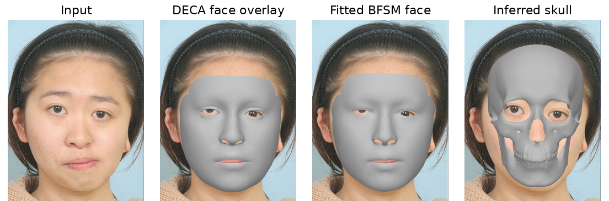
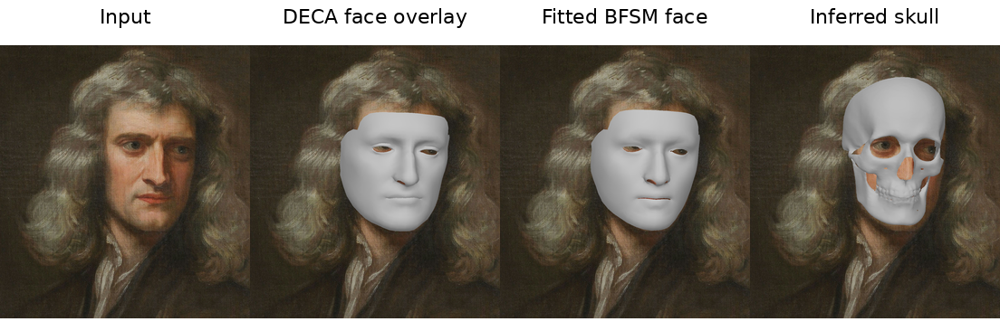
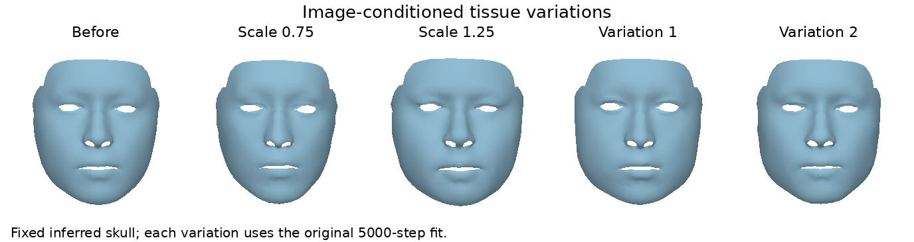
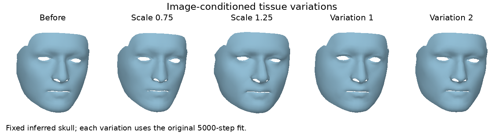
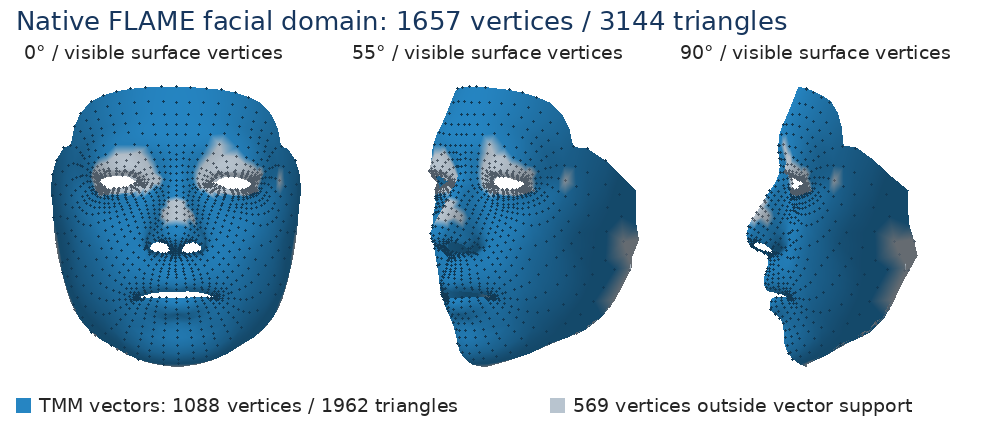
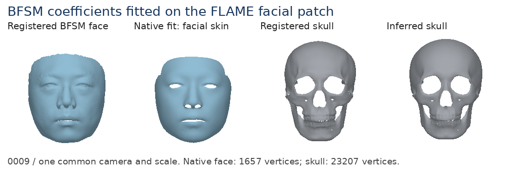
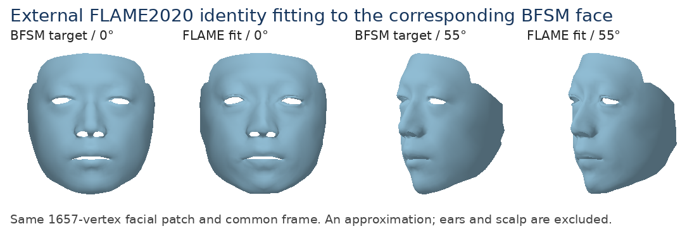

# 5. Applications: facial FLAME topology

[Project home](../../README.md) · [Environment](../../environment/README.md) · [Assets](../../assets/README.md)

This module provides BFSM on a FLAME facial-skin topology, image reconstruction through DECA, and fitting between corresponding BFSM and FLAME faces. Coefficients in the native representation remain BFSM coefficients. The native BFSM representation covers facial skin and its coupled skull; it does not add scalp, ears, neck or eyeballs.

In cases such as hemifacial microsomia (HFM), the affected ear can be difficult to reconstruct and bring into consistent topology across cases. The FLAME facial patch used here also has fewer vertices than the original BFM-based face topology, limiting the geometric detail it can represent. These considerations motivated our original choice of the denser BFM-based topology and our focus on the facial region rather than the ears.

## Environment and assets

Install the shared core and this module from the repository root:

```bash
python -m pip install -e . -e modules/05_applications
```

Use the `cpu` and `torch` capabilities together, or `all`, for complete tissue-face fitting. NumPy/SciPy alone supports the low-level native decoder and the two linear identity-fitting routes. DECA needs Torch, its external encoder/checkpoint and the matching prepared FLAME model; automatic detection additionally needs `face-alignment==1.4.1` and cached FAN/SFD weights. See [asset preparation](../../assets/README.md#flame-correspondence-and-masks) and the [environment guide](../../environment/README.md). `--device cpu` is available when GPU execution is not required.

The native models are built locally from the original BFSM FSMM/TMM and licensed correspondence/mask inputs. External FLAME fitting and DECA also require the locally prepared FLAME2020 neutral model. Provider models and generated FLAME mesh files are not bundled. `VT_FLAME_MODEL_DIR` selects another native model directory.

## Image-only reconstruction

Reconstruct from a single photograph or artwork. FAN detects landmarks automatically; no CT surface, precomputed landmark file or previous Module 3 reconstruction is required.

```bash
python -m bfsm_applications.deca --image path/to/image.jpg \
  --deca-root assets/external/DECA --flame-neutral assets/external/flame/flame_neutral.npz \
  --device cuda:0 --iterations 100 --output data/output/runs/flame_image/deca
```

### Example 1

```bash
python -m bfsm_applications.deca --image data/input/image_clinical/1.png \
  --deca-root assets/external/DECA --flame-neutral assets/external/flame/flame_neutral.npz \
  --device cuda:0 --iterations 100 --output data/output/runs/flame_clinical/deca
```



### Example 2

```bash
python -m bfsm_applications.deca --image data/input/image_portrait/2.jpg \
  --deca-root assets/external/DECA --flame-neutral assets/external/flame/flame_neutral.npz \
  --device cuda:0 --iterations 100 --output data/output/runs/flame_portrait/deca
```



DECA's original coarse encoder predicts identity, expression, global/jaw pose and camera from its 224-pixel crop. FLAME decoding applies the 100 identity and 50 expression coefficients, pose correctives and joint skinning. The existing regularized 100-iteration BFSM fit approximates this posed, expression-bearing facial surface using 200 shared coefficients and predicts its coupled skull. Both faces and the skull are projected with the predicted DECA camera and the inverse crop transform for overlays on the input image. BFSM uses its own shared geometry model to approximate the DECA expression; it does not introduce a separate expression or jaw-articulation model for the skull.

| Output in each `deca/` directory | Meaning |
| --- | --- |
| `network_input.png` | Actual detector/encoder crop |
| `reconstruction.png` | Input image and camera-aligned DECA face, BFSM face and skull overlays |
| `deca_face.obj` | FLAME facial patch with predicted expression and global/jaw pose |
| `bfsm_face.obj`, `bfsm_skull.obj` | Fitted native BFSM face and inferred coupled skull in the posed FLAME frame |
| `reconstruction.npz` | Encoder parameters, identity, geometry, crop transform, reliability weights and fitted similarity |

The inferred skull is not CT data or observed anatomy. [Image sources and modification notices](../../data/input/IMAGE_SOURCES.md) apply to the example inputs and reproduced crops.

### Image-conditioned tissue variations

Use each image reconstruction's shared identity to construct its corresponding original-order BFSM face/skull pair. As in the original tissue demonstration, its paired displacement `d_i = skull_i − face_i` supplies the conditioned mean; the original TMM basis supplies independent changes. Each of the four variations runs the complete original five-stage **5000-step** fit before projection to the full 1657-vertex native face.

```bash
python -m bfsm_applications.conditioned_tissue \
  --reconstruction data/output/runs/flame_clinical/deca/reconstruction.npz \
  --output data/output/runs/flame_clinical/tissue --device cuda:0 --seed 0

python -m bfsm_applications.conditioned_tissue \
  --reconstruction data/output/runs/flame_portrait/deca/reconstruction.npz \
  --output data/output/runs/flame_portrait/tissue --device cuda:0 --seed 0
```





`before_face.obj` is the image-derived BFSM face. `s0.75.obj` and `s1.25.obj` scale its paired displacement, with zero tissue coefficients. `id1.obj` and `id2.obj` use independently sampled tissue coefficients at unit thickness; these labels denote samples, not people. `skull.obj` stays fixed. Each `*_parameters.npz` retains conditioned displacements, coefficients, full original targets, source/native face arrays and the saved frame transform.

Fitting operates in the original BFSM frame, preserving all repeated face/skull observations. Only afterward is the complete fitted face projected through A and returned once through the saved DECA similarity. BFSM tissue vectors are never directly added to a differently scaled FLAME-space mesh. These are model variations, not measured tissue thickness or predictions of treatment. A reconstruction with unreliable input regions retains model-prior assumptions there.

## Native representation and population decoding

The native FSMM contains **1657 facial vertices / 3144 triangles**, 200 shared BFSM identity components and the original-order **23207-vertex skull**. Its independent vector TMM has direct support at **1088 vertices / 1962 triangles**.



The blue region marks direct vector support; gray marks the remaining 569 vertices. This mask is a correspondence display, not a thickness measurement. The full fitted TMM face includes all 1657 vertices because it is produced by the original BFSM face fit followed by A, rather than by treating sparse vector endpoints as a complete face.

```bash
python -m bfsm_applications.decode --output data/output/runs/native_model \
  --seed 27 --identity-std 0.5 --tissue-std 0.5 --device cuda:0
```

`face.obj` and `skull.obj` share sampled identity coefficients. `tissue_face.obj` uses independent tissue coefficients, the same fixed skull, and the full 5000-step original face fit. The output has 1657 vertices / 3144 triangles. `coefficients.npz` also stores original paired targets, fitted parameters and the 1088 direct endpoints as diagnostics. The low-level `NativeTissue.decode` remains a vector-endpoint operation; it does not itself produce the complete fitted face.

`--source-fsmm` and `--source-tmm` select the original-topology source models for tissue fitting. Defaults are `assets/models/fsmm_200.npz` and `tmm_200.npz`. The native A, mapped means/bases, joint center, skull topology and C/R/H operators must match those source models; incompatible versions are rejected.

## Fitting a corresponding mesh

First register arbitrary-topology scans using [Module 1](../01_topology_and_modeling/README.md). The supplied original inputs are `data/input/sample_001/raw/`; the corresponding result must have the original 35709-point BFSM face order:

```bash
python -m bfsm_topology.demo --input data/input/sample_001/raw \
  --output data/output/runs/sample_001/registration --device cuda:0 --deterministic --seed 0

python -m bfsm_applications.fit_native \
  --bfsm-face data/output/runs/sample_001/registration/posed/topology_face.obj \
  --regularization 1 --iterations 30 --output data/output/runs/sample_001/native_flame

python -m bfsm_applications.fit \
  --face data/output/runs/sample_001/registration/posed/topology_face.obj \
  --flame-neutral assets/external/flame/flame_neutral.npz \
  --regularization 0.001 --iterations 30 --output data/output/runs/sample_001/fitted_flame
```





The native fit estimates BFSM identity and predicts a coupled skull. The external fit estimates FLAME2020's separate 300 identity coefficients and produces a face approximation, not a skull. `--flame-face` on `fit_native` instead accepts an original-order 5023-point FLAME observation or this native facial patch. Raw scans and high-resolution ARAP outputs cannot be passed directly to A. A postoperative adapter is available:

```bash
python -m bfsm_applications.project --face /path/to/corresponding_35709_face.obj \
  --output data/output/runs/predicted_flame_face.obj
```

This projects the completed upstream result and optional vertex colors; it does not reformulate postoperative optimization on the new topology.

### Reliability and saved coordinates

Both fitting routes accept `--weights`: an NPY vector in original FLAME5023 order or native1657 order. Zero excludes missing observations; positive values are relative reliability. Default output faces retain only complete triangles with positive weights. `--include-unobserved` writes a separately named prior-completed face, which is not evidence of missing anatomy. There is no symmetry constraint. In HFM and other malformations, a FLAME identity prior can remain inappropriate even for the remaining facial region.

`fit_native` saves identity and similarity in `coefficients.npz`; external fitting uses `flame_fit.npz`. With row vectors:

```text
input_frame_vertices = scale * canonical_model_vertices @ rotation + translation
```

Decode native geometry with `recenter=False` before applying that transform to both face and skull. A `posed/` input produces normalized-frame outputs; a corresponding `world/` input produces outputs in that original scan frame. Do not overlay one frame directly on another. DECA's fitted similarity maps the uncentered native BFSM to the posed FLAME reconstruction. Its predicted weak-perspective camera and saved original-to-crop matrix supply the separate image projection.

### Correspondence and tissue operators

A composes the original 53215-to-FLAME map with the BFSM crop and the facial-skin mask. Ears, scalp, neck and eyeballs are excluded. Fixed missing rows are completed on neutral templates using 15% graph-harmonic interpolation and 85% closest-surface projection. This is a topology-derived representation, not a lossless conversion. Its mean/basis are A times the original BFSM face arrays; the original joint center is retained. The 200 transformed basis columns are not promised orthogonal or recomputed PCA components.

For direct vector support, R averages repeated observations per original face vertex, C is the fully supported subset of A R, and H combines C with the original skull selection. The low-level endpoints are `H skull − C d(beta)`. Complete tissue-face demonstrations instead fit **all original paired targets without first averaging them**, then project the fitted BFSM face through A. Population decoding uses the original TMM mean; conditioned examples use their own paired displacement mean. Boundary completion remains a model assumption.

FLAME and DECA retain their provider terms; see the [third-party notices](../../THIRD_PARTY_NOTICES.md). The rendered outcomes are PNG illustrations. Original models, weights, correspondence inputs and generated FLAME meshes are obtained or produced locally under those terms.
